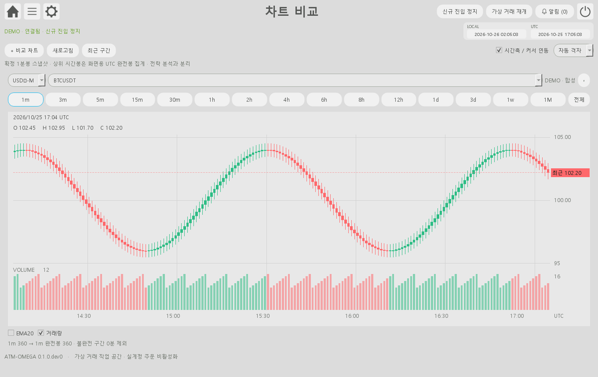
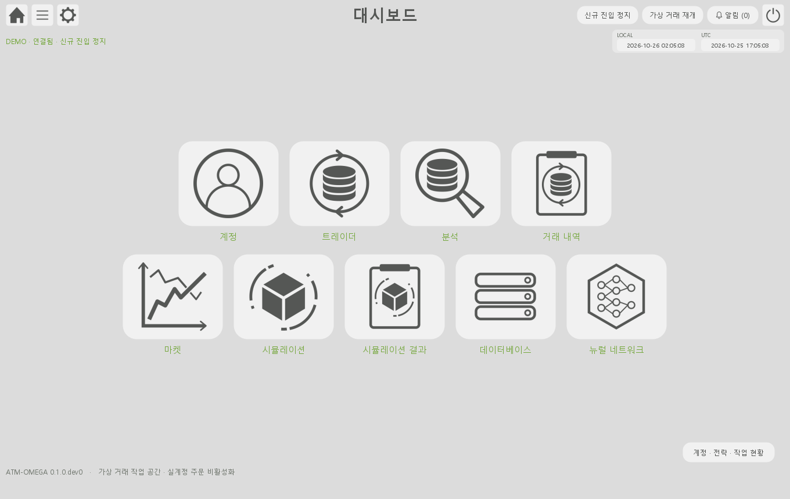
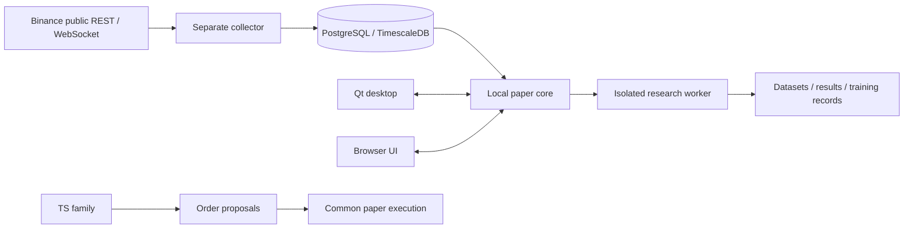

# AutoTradeMachine_Omega


[](./README.md)



Eta 디자인을 계승한 독립 Qt 데스크톱 — 합성 차트 미리보기, 실계정 주문 비활성.

가상 마진 거래 내역은 고정 스냅샷 페이지 조회·UTC 기간 선택·CSV/manifest ZIP
출력을 GUI와 코어 콘솔에서 제공합니다. NN 기록 한도는 시작 설정으로 바꾸고
화면에서 사용량을 확인할 수 있습니다. 자세한 내용은
[설정 안내](config/README.md#full-virtual-margin-ledger)를 참고하세요.



---

### 📖 프로젝트 소개

**Auto Trade Machine Omega (ATM-Omega)**는 [ATM-Eta](https://github.com/kimlvis31/AutoTradeMachine_Eta)의 후속 프로젝트입니다. Eta의 1분봉 데이터 기반과 TEF 계산식을 계승하면서 전략·회계·거래소 어댑터·연구 작업·데스크톱 화면의 책임을 분리하고 있습니다.

현재 **초기 통합판**은 로컬 paper 코어, 선택 설치하는 독립 Qt 데스크톱, Binance 공개 데이터 수집기, 오프라인 연구 작업을 연결합니다. **Build → Test → Execute**가 개발 목표입니다. 학습 모델은 명시 활성화하는 CPU Shadow 추론과 별도 확정 입력 기반 가상 전략 연결을 지원합니다. 실계정 실행은 비활성화돼 있으며 현재 실행 경로는 실제 거래소 주문을 전송하지 않습니다.

#### 핵심 기능

| 영역 | 현재 제공 기능 | 초기판의 경계 |
| :--- | :--- | :--- |
| 시장 데이터 | Binance 현물·USD-M 확정 1분봉, WebSocket·REST 복구, PostgreSQL/TimescaleDB, 선택적 paper 봉 공급 | 별도 수집기·수동 재시작. Paper 공급에는 warmup·최신 연속 데이터·명시적 설정 필요 |
| 분석 | 공유 집계·이동평균·밴드·인과 분석 생성기, 저장 템플릿·종목 인스턴스·확정 DB 기반 독립 실행 | 전략은 고정 snapshot 사용. 실시간 호가는 연속성·범위 품질을 검사하며 과거 호가는 미지원. 보조 입력 전략은 명시 수집 구독과 유효한 관측 필요 |
| Trade Strategy(TS) | manifest registry, 공통 주문 제안 계약, `tef`·`target_quantity`·데모 `neural_signal` family, 오프라인 검증기 | 정규화 exposure는 TEF 내부 개념이며 실거래 연결은 미완성 |
| Paper 계정 | 기존 v1 계정과 선택 실행하는 증거금 v2 TS 세션, 교차·격리 회계, durable intent·다음 봉 체결·시나리오 funding·재생과 공유하는 선택적 고정 슬리피지/지연 | v1은 레버리지 1. V2는 OHLCV 대용 평가가격·전량 체결·명시 브래킷 가정 사용. 비용·funding은 가정이며 실제 거래소 체결·지급 내역이 아님. 청산·부분 체결·가격 충격 미지원. v2는 보조 입력 TS 그래프에 고정된 native 체결 합계·호가·metric을 공급하며 관측 품질과 수치 warmup이 필요 |
| 데스크톱 | 독립 Qt 화면, Eta 대시보드, 접이식 패널, TS·분석 설정 폼, 비교 차트, 체결 이력, DB 제어, 연구·결과 뷰어 | Eta 전체 표시·보고서 호환은 미완성. 실제 음성 청취는 추가 검증 필요 |
| 연구 | dataset 원본·split 기록, seed 기반 Monte Carlo, CPU replay, 외부 Python NN 학습·기록 | GPU 시뮬레이션·Eta 전체 실행 호환·실거래 NN 배포는 미완성 |
| 모바일 | 반응형 브라우저 UI, 기기 등록·철회, v1/v2 가상 포지션 캐시 조회·정지·재개 권한, 지원 브라우저의 PWA 정적 화면 설치, 명시 설정하는 개인 HTTPS 프록시 origin·선택적 Web Push 발신 | Core는 loopback 전용. 별도 TLS·개인망 구성이 필요하며 실제 휴대폰의 외부 접속·알림 도착은 미검증. Native 앱은 없으며 오프라인 금융 상태는 미확인으로 표시 |

GUI는 인증된 로컬 HTTP로 코어에 연결하며 독립적으로 종료·재접속할 수 있습니다. GUI 자동 시작 기본값은 `false`입니다. 코어는 정지 상태로 시작하며 재시작 후 수동 재개가 필요합니다. 신규 진입 정지는 이미 제출한 주문을 취소하지 않습니다. 거래소 조건부 보호 주문은 사용하지 않습니다.

---

### ▶️ 실행 방법

코어 입력 콘솔·별도 로그 창·변경 가능한 설정과 GUI 없이 사용하는 명령은
[설정·터미널 사용 설명](./config/README.md)을 참고합니다.

저장소를 내려받고 루트 디렉토리로 이동합니다.

```sh
git clone git@github.com:kimlvis31/atm-omega.git
cd atm-omega
```

#### Windows 🪟

```powershell
.\setup.bat --gui
.\run.bat
# 합성 차트를 바로 보려면 메뉴에서 3 선택
```

#### Linux 🐧

```sh
bash ./setup.sh --gui
bash ./run.sh
# 합성 차트를 바로 보려면 메뉴에서 3 선택
```

Linux Qt에는 그래픽·폰트·데스크톱 시스템 라이브러리도 필요합니다. Debian 기반 offscreen 검사에서는 `libgssapi-krb5-2`, `libxcb-cursor0`, `libegl1`, `libgl1`, `libxkbcommon0`, `libdbus-1-3`, `libfontconfig1`, `libglib2.0-0`, `fonts-noto-cjk`를 사용했습니다. 배포판별 패키지명은 [Qt Linux 요구 사항](https://doc.qt.io/qt-6/linux-requirements.html)을 참고합니다. Setup은 Python wheel만 설치하며 OS 패키지를 설치하지 않습니다.

인자 없이 터미널에서 `run`을 실행하면 메뉴를 유지합니다. **1**은 GUI 연결, **2**는 현재 터미널에서 코어 실행, **3**은 백그라운드 데모 코어와 GUI 실행, **0**은 메뉴 종료입니다. 이미 코어가 있으면 데이터 소스를 바꾸지 않고 재사용합니다. GUI·메뉴를 닫아도 코어는 유지되며 미리보기 시작 시 PID와 launcher 로그 경로를 안내합니다. **Ctrl+C**로 종료할 수 있는 코어를 원하면 `core.bat --demo`(Linux `bash core.sh --demo`)를 실행하고 다른 터미널에서 `gui.bat` / `bash gui.sh`를 실행합니다. 인자를 주거나 입력을 리다이렉트한 경우 기존 비대화형 CLI 방식으로 동작합니다.

`--demo`는 합성 차트 데이터를 명시적으로 사용하고, 없을 때 `data/demo-candles.csv`를 만듭니다. 거래소에서 받은 데이터가 아닌 예제입니다. 데스크톱 연구 화면에서 이 CSV를 dataset export 원본으로 선택할 수 있습니다. 데모 시작만으로 계정 생성·전략 실행·NN 학습이 자동 수행되지는 않습니다.

`--demo` 없이 실행한 차트는 DB snapshot을 읽고, DB가 준비되지 않으면 사용 불가 상태를 표시합니다. 차트 조회만으로 전략이 실행되지는 않습니다. 거래 화면에서 확정봉 수동 입력 또는 DB 자동 공급을 명시적으로 선택합니다. 공급기는 거래 없이 지표를 준비한 뒤 commit된 확정 1분봉을 공통 frame으로 처리하고 결측·오래된 데이터를 제한합니다. 데이터 단독 복구는 자체 제한만 해제하며 사용자 정지·재시작 복구 조건은 별도로 유지합니다. 실제 거래소 주문이 아닌 paper 실행입니다.

기존 v1 paper 계정의 잔액 단위는 USDT이며 Binance의 USDT 현물·USD-M 종목을 받습니다. 별도 증거금 v2 호스트는 USDT를 quote로 사용하는 USD-M 종목을 받습니다. 연구 replay는 종목의 quote 통화를 명시해 다른 통화도 선택할 수 있지만, 한 wallet에 서로 다른 통화를 합산하는 구성은 거부합니다. 환전 계산은 제공하지 않습니다.

#### 데스크톱 사용 흐름

전원 메뉴는 GUI만 닫기와 코어 종료를 구분합니다. 열린 포지션이 있으면 상태 저장 후 종료·취소·정리 후 종료를 선택합니다. 저장 종료는 로컬 관리 중단 확인이 필요합니다. 정리는 v1과 교차/격리 v2의 모든 금융 owner를 먼저 확인하고 다음 유효 분봉의 체결을 기다립니다. 금융 상태가 불명확하면 완료로 표시하지 않으며, 전략 모델 오류가 별도 금융 정리까지 막지는 않습니다. 취소해도 제출된 감소 주문과 신규 진입 정지는 유지합니다. 코어 재시작 후 전략은 수동 복구하며 연결이 끊긴 것만으로 종료 완료로 판단하지 않습니다.

밝은 회색·라임 테마, Eta 원본 아이콘과 4+5 대시보드 배치를 계승했습니다. 홈·제목·개별 LOCAL/UTC 시계 box를 유지하며 메뉴에서 추가 화면을 선택합니다. 정지·재개는 최상단에 두고 계정·전략·작업 상세는 필요할 때 펼칩니다. 저장된 테마·언어는 밝은 기본값보다 우선합니다.

실험용 CPU NN shadow 경로는 학습 결과를 고정하고 독립 연구 프로세스에서 fixture를 검증한 뒤 명시적으로 활성화합니다. 준비한 숫자 입력 또는 명시적으로 동의한 원시 OHLCV 회고 입력을 모듈 전처리에 넘겨 예측을 확인할 수 있으며 TS 주문에는 연결하지 않습니다. 코어 재시작 후에는 스트림을 수동 초기화·재개해야 합니다.

신경망 화면에는 초기 접힌 **저장 확정봉 추론** 패널도 있습니다. 완료된 학습을 선택하고 모듈 신뢰·tensor/출력 계약 확인→활성화→stream 초기화→실제 저장된 확정 분봉 추론을 명시적으로 요청합니다. 코어가 PostgreSQL 자료의 실제 가용 시각을 확인하고 재사용 가능한 CPU child에서 모듈 전처리와 추론을 수행합니다. 결과·내부 상태의 저장 ACK 뒤에만 값을 공개하며 기한이 지나면 표시에서도 제거합니다. 정상 NoSignal은 feature 없이 기억·cursor만 진행합니다. 요청 전송·상태가 불확실하면 새로 초기화해야 하며, 재시작 후에도 수동 복구합니다. 가상 증거금 v2 화면에서 등록된 stream을 데모 neural_signal 전략에 명시적으로 연결할 수 있습니다. 정확한 봉·모델·epoch·유효기간과 저장된 금융 핀을 확인한 신규 주문만 허용하고, 신호 부재·만료 때도 이미 접수된 주문과 모듈 소유 로컬 보호는 유지합니다. 늦은 결과로 이미 소비한 분봉을 다시 판단하지 않습니다. 콘솔 조회는 `causal-inference`, 제어 계약은 [owner API 안내](config/README.md#committed-inference-owner-api)를 참고하세요.

교차·격리 증거금의 별도 실험용 수동 시나리오 터미널은 `run.bat margin --help` / `bash run.sh margin --help`로 확인할 수 있습니다. 원래 주문과 체결 기록을 보존해 복구하며, `config/examples/margin-*.json` 예제를 제공합니다. 이 터미널은 사용자가 넣은 시나리오만 실행합니다. 별도의 **가상 증거금 v2** 화면은 확정 DB 분봉으로 TS를 자동 평가하고 교차·격리 회계를 처리합니다. 기존 v1 레버리지 1 계정은 자동 변환하지 않으며, 두 경로 모두 실제 주문을 보내지 않습니다.

- **차트:** 최대 6개 종목의 시간·커서 연동, 고정 봉 선택, 가격·거래량 독립 축과 선택적 EMA20을 제공합니다. 1분~달력 주·월봉의 15개 주기를 지원합니다. 휠은 마지막 클릭 영역을 따릅니다(그래프=시간 확대, 시간축=이동, 값축=무동작). 그래프 드래그는 이동, 시간축 드래그는 가로 확대, 값축 드래그는 세로 확대이며 그래프 우클릭은 값 범위 맞춤입니다. 상위 봉은 연속된 UTC 1분봉이 모두 있어야 표시하며 전략 입력을 바꾸지 않습니다. 설정 패널에서 세 슬롯에 VOL/MFI/MMACD/DMIxADX를 배정하고 계산·표시를 따로 선택합니다. DMI는 지원되는 1m~1d 기간의 확정 DB 분봉을 공통 코어 생성기로 계산하며, 과거 표시 계산의 실제 시각과 준비 부족을 구분합니다. 표시값 변경은 결과를 재사용하고 기존 profile은 메모리에서 호환 변환한 뒤 명시 Save 때만 저장합니다. 이름별 profile과 6개 차트 구성을 명시적으로 저장할 수 있으며 시간대 표시는 UTC 원본을 바꾸지 않습니다. 매매 표시는 선택한 paper 전략의 실제 기록된 체결만 사용합니다.
- **분석:** 템플릿 저장·복제, 종목별 인스턴스와 EMA/MMACD/SMA/WMA/BOL/MFI/DMIxADX/SWING/PSAR/NES/WOI/MST/STS/TPD/IVP 구조화 설정을 제공합니다. 저장된 DB 분봉으로 CA 분석만 시작·정지하고 준비 진행·품질·결과를 확인할 수 있으며 코어 재시작 후에는 수동으로 재개합니다. NES/MST는 확정 체결 합계·실제 지표 관측을 revision·가용 시각·품질·나이 기준으로 읽습니다. 중단된 처리 구간은 입력 manifest에 고정된 자료로 재개하고 필수 자료가 없으면 진행을 차단합니다. DB 페이지에서 체결 합계·native 지표의 연속 수집을 명시적으로 구독할 수 있습니다. DB 공급 v1 paper 전략은 선택된 입력을 고정해 사용하며, 보조 자료가 없을 때도 기존 주문·봉 기반 보호 처리를 유지하고 신규 진입을 제한합니다. 실시간 호가는 연속성과 필요한 가격 범위를 관측한 경우 WOI/STS 입력으로 사용할 수 있습니다. partial/missing 입력은 준비 완료로 보지 않으며 과거 호가를 만들어 넣지 않습니다. 전략은 고정 snapshot을 사용합니다. IVP는 실제 체결가별 거래량이 아닌 OHLCV 해석 분포이며 `setup.bat --analysis` / `bash setup.sh --analysis` 선택 설치가 필요합니다.
- **거래·이력:** 계정·전략 선택, manifest 설정 폼, 저장 분석 연결과 선택적 DB 공급을 제공합니다. 고급 JSON도 사용할 수 있습니다. 비율은 정확한 ratio로 저장하고 실제 체결·수수료는 통화별로 표시합니다. 전체 Eta 보호·재진입 및 실행 subscription 호환은 미완성입니다.
- **시뮬레이션 결과:** 완료된 replay의 요약·자산/낙폭·체결·사건·가정을 조회합니다. 기록된 설정을 새 setup 초안으로 복사할 수 있으며 자동 실행하지 않습니다.
- **데이터베이스:** 기본 접힘 상태의 연속 보조 수집 패널에서 전략 수요 확인·구독 적용·정지·불확정 작업 재개를 제공합니다. 구독 희망과 실제 데이터 준비는 구분하며 코어 재시작 후 수동 적용이 필요합니다. 현물·USD-M 선택, 종목 검색·선택, NONE/STREAM/ALL 수집 설정, 저장 구간·내부 결측 확인, 결측 재수집, 로컬 네트워크 DB에서 누락 관측 가져오기를 제공합니다. 작은 창에서는 같은 컨트롤을 3개 탭으로 재배치하고 선택을 유지합니다.

**차트 → 해당 차트의 설정 → 가격 지표**에서 SMA·WMA·BOL을 종류별 10개 선까지 설정합니다. 종류 사용·선 계산·선 표시를 따로 선택하며, 새 지표는 기본으로 꺼져 있습니다. BOL 중심은 SMA/WMA/EMA 중 선택하고 중심선·밴드를 독립적으로 표시합니다. 밴드 배수의 0·음수도 그대로 보존합니다. 적용은 현재 화면만 바꾸며 이름으로 저장·차트 구성 저장은 명시적으로 수행합니다. 이전 프로필은 저장 전까지 메모리에서만 호환 변환합니다.

차트 요청이 8번 연속 확인되지 않으면 자동 조회를 멈춥니다. **같은 요청 조회**는 계산을 새로 제출하지 않고 기존 요청을 한 번 확인합니다. 정상적인 대기 응답이 확인되면 자동 조회가 재개되며, 색·언어 변경이나 재연결로 조회 제한을 초기화하지 않습니다.

확정된 DB 1분봉을 공통 코어 계산기에 묶어 요청하며 1분~1일 봉을 지원합니다. 최초 사용이나 새 코어 연결 뒤에는 **원본 재조회**를 눌러 원본을 확인합니다. 합성 데모·달력 주기는 지원하지 않습니다. 차트별 재생 시작점을 고정하고 한 번에 최대10,000분을 계산합니다. 고급 UTC 밀리초 시작점을 비우면 처음 확인한 분에 고정하며, 범위를 넘으면 시작점을 명시적으로 새로 정합니다. 준비 중인 값과 결측을 구분하고 원본 내용·응답 코어가 일치한 결과만 표시합니다. 색·표시 여부·중심선·밴드 변경은 기존 값을 재사용합니다. 과거 자료를 조회한 표시이며 당시 사용 가능했던 매매 신호를 뜻하지 않습니다.

DB 제어는 인증된 코어 API를 사용하며 GUI에서 PostgreSQL에 직접 연결하지 않습니다. LAN 가져오기는 private/loopback IP로 지정한 **Omega v2** 피어를 읽기 전용 transaction으로 조회하고 기존 관측을 보존하며 피어 비밀번호를 저장하지 않습니다. Eta DB에는 별도 이관 어댑터가 필요합니다. 결측 복구는 실제 관측을 채우는 기능이며 보간·Monte Carlo는 연구 dataset에서만 수행합니다. 가용률은 저장된 최초~최신 관측 사이의 내부 결측 기준이고 상세 구간 목록은 최신 관측 기준 20,000분으로 제한합니다. 공개 호가는 별도 호가 패널에서, 체결 합계와 native OI/long-short 지표는 bounded/연속 보조 수집 경로에서 수집합니다. 과거 호가, GUI 압축·초기화 제어와 수집 ETA는 미지원입니다. 수집 설정이 worker 준비 완료를 뜻하지 않으며 코어 재시작 후 수집기는 수동으로 다시 시작해야 합니다.

#### 공개 시장 데이터 수집

DB 명령에는 실행 중인 Docker Engine/Compose(Windows는 Docker Desktop)가 필요합니다. 거래소 API key는 필요하지 않습니다.

```powershell
# Windows
.\run.bat db init
.\run.bat collect --market usdm --symbols BTCUSDT ETHUSDT --db-config database.config.toml
```

```sh
# Linux
bash ./run.sh db init
bash ./run.sh collect --market usdm --symbols BTCUSDT ETHUSDT --db-config database.config.toml
```

현물은 `--market spot`으로 선택합니다. 수집기 하나에서 하나의 시장과 최대 128개의 서로 다른 종목을 지정할 수 있습니다. `--lookback-minutes` 기본값은 500, 허용 범위는 1~20,000분입니다. 전체 옵션은 `run.bat collect --help` 또는 `bash run.sh collect --help`로 확인합니다.

**선택형 REST 응답 원문 보존(기본 OFF):** 코어가 관리하는 수집기와 수동 REST
누락 구간 재조회에 적용하려면, 코어를 시작하기 전에 기존 `master.config.toml`의
collection 항목을 설정합니다.

```toml
[collection]
capture_rest_raw = true
```

예제 설정의 기본값은 `false`입니다. 코어의 원문 페이지와 수신 기록은
`[paths].data_dir/raw/candles`에 저장됩니다. 기본 경로는 Omega 루트 기준
`./data/raw/candles`입니다. 독립 실행 `collect`는 이 시작 설정을 읽지 않으므로
별도의 명시적 옵션을 사용합니다.

```powershell
.\run.bat collect --market usdm --symbols BTCUSDT --db-config database.config.toml --capture-rest-raw --raw-directory data/raw/candles
```

```sh
bash ./run.sh collect --market spot --symbols BTCUSDT --db-config database.config.toml --capture-rest-raw --raw-directory data/raw/candles
```

독립 수집에서 `--raw-directory`를 생략하면 DB 설정 파일이 있는 폴더 아래의
`data/raw/candles`를 사용합니다. 직접 지정한 상대 경로는 수집기의 작업 폴더를
기준으로 합니다. `--raw-directory`에는 `--capture-rest-raw`가 필요합니다.
보존 옵션을 생략하면 기존의 정규화 REST 경로를 사용하며 REST 원문 저장소를
생성하지 않습니다.

저장하는 원문은 실제 HTTP 응답의 **본문 바이트**와 수신 시각·요청 구간·종목·내용
해시입니다. TCP/TLS 패킷을 캡처하는 기능은 아닙니다. 각 확정 분봉에는 원래 JSON
행의 UTF-8 텍스트를 그대로 연결해 PostgreSQL에 보관합니다. 숫자 표기와 이스케이프를
유지하며 `source="rest"`, `raw_source="rest"`, 원래 `raw_received_at_ms`를
기록합니다. 응답 처리 후의 정규화 관측 접수 시각은 원문 수신 시각과 별개이며,
봉 마감 시각으로 수신 시각을 만들어 넣거나 보정하지 않습니다.
전체 페이지는 8MiB, 분봉별 원문 행은 64KiB까지 허용합니다. 원문 페이지는 내용 해시로
저장하지만, 응답별 기록과 DB의 원문 텍스트도 추가 디스크 공간을 사용합니다.
이는 개별 기록의 크기 제한이며 전체 저장 용량 제한이 아닙니다. 자동 삭제나
보존 기한 정리는 수행하지 않습니다.

보존을 켠 상태에서 원문 저장 실패·실제 수신 시각 누락·잘못되거나 지나치게 큰 응답이
발생하면, 해당 REST 조회의 새 관측을 게시하지 않고 수집/재조회 실패로 알립니다.
이미 확정된 관측은 유지합니다. 이 옵션은 켜진 동안 새로 조회한 응답을 보존하며,
기존 원문 누락 행을 채우거나 이미 버린 과거 응답을 복구하지 않습니다. 나중에 다시
조회하면 새 수신 시각을 가진 별도의 응답입니다. Raw export는 예전 원문이 없는
항목을 계속 누락으로 표시하며 정규화 OHLCV에서 원문을 재구성하지 않습니다.

#### 저장 데이터 export와 TS 검증

```powershell
.\run.bat export --instrument binance:usdm:BTCUSDT --output data/BTCUSDT.csv
.\run.bat export --instrument binance:usdm:BTCUSDT --output data/BTCUSDT-raw.jsonl --raw
.\check_ts.bat
.\check_ts.bat tef
.\check_ts.bat target_quantity --json
```

Linux에서는 같은 인자로 `bash ./run.sh export ...`, `bash ./check_ts.sh ...`를 사용합니다. Export는 PostgreSQL에 commit된 최신 관측을 읽으며 기본 10,000행을 내보내고 기존 출력 파일을 덮어쓰지 않습니다. CSV는 정규화 OHLCV이며, `--raw`는 저장된 수신 payload와 원본 존재 여부를 JSONL로 기록합니다. 원본이 없으면 표시하며 OHLCV에서 복원하지 않습니다. Raw JSONL은 원본 확인용 기록이며 정규화된 연구 dataset 입력과 형식이 다릅니다.

`check_ts`를 인자 없이 실행하면 감지한 family 목록을 보여주고 선택을 받습니다. `--list`는 코드를 import하지 않고 manifest만 읽습니다. 검증기는 초기 오프라인 공통 계약·family별 사례를 확인하며 전체 회계·복구 검증이나 거래 준비 완료를 뜻하지 않습니다. 외부 TS 실행에는 명시적 신뢰 설정이 필요합니다(검증기 `--allow-external`, 코어 `--trust-ts`). 선택한 Python 코드는 사용자 권한으로 실행됩니다.

#### 설치 옵션

설치에는 **CPython 3.13**이 필요합니다. Setup은 저장소 안의 `.venv`를 생성·재사용하고 해시를 확인한 의존성과 프로젝트를 설치한 뒤 의존성 정합성을 검사합니다. 로컬 DB 설정과 `secrets/`의 무작위 비밀번호 파일을 만들며 기존 파일은 덮어쓰지 않습니다. Docker·수집기·코어는 별도로 실행합니다.

- 기본 설치는 실행·빌드 의존성만 포함합니다. Qt는 `--gui`, 개발 도구는 `--dev`로 추가합니다. 선택형 PyTorch는 `--neural-cpu` 또는 Windows x86-64 표준 CPython 3.13의 `--neural-cuda` 중 하나를 선택합니다. NN 옵션은 GUI·개발 도구와 함께 쓸 수 있고 큰 NN 패키지를 기본 설치하지 않습니다. CUDA 옵션은 공식 Torch 파일의 고정 hash를 확인하고 나머지 고정 의존성을 PyPI에서 설치하며, `--wheelhouse`를 주면 로컬 파일만 사용합니다. GPU driver 설치나 학습 장치 선택은 수행하지 않습니다.
- `setup.bat --neural-cuda`를 명시하면 프로젝트 `.venv`의 Torch가 CUDA 12.6 변형으로 바뀝니다. 기존 CPU 환경을 보존하려면 별도 프로젝트 복사본을 쓰거나 `.venv`를 직접 다른 곳에 보관하세요. 기존 CPU checkpoint를 CUDA 변형으로 자동 변환하거나 호환 검사를 우회하지 않습니다.
- `OMEGA_PYTHON`으로 설치된 Python 실행 파일을 지정합니다. 필요한 wheel을 모두 보유하면 `--wheelhouse /path/to/wheels`로 오프라인 설치할 수 있습니다.
- 재실행 시 환경을 유지합니다. 호환되지 않거나 불완전한 `.venv`는 사용자가 별도로 옮겨야 합니다. Linux에서는 배포판의 Python 3.13 venv 지원 패키지가 필요할 수 있습니다.
- 선택 GUI 패키지는 PySide6 Essentials/Addons와 shiboken6 **6.12.0**입니다. QtWidgets/QtNetwork를 사용하며 QtWebEngine은 필요하지 않습니다.
- `--speech`로도 같은 Qt 의존성을 설치해 GUI 없이 코어 음성 알림을 사용할 수 있습니다. GUI 자동 시작을 켜지는 않습니다. 설정에서 언어·설치된 음성·속도·음량을 선택하고 미지원 상태를 확인합니다. `console.bat` / `console.sh`와 `logs.bat` / `logs.sh`는 입력·응답과 로그 조회를 분리합니다.

---

### ✅ 요구 사항·저장소

| 구성 요소 | 요구 사항 |
| :--- | :--- |
| Python | CPython 3.13; 개발 기준 세부 버전은 [`.python-version`](./.python-version) 참고 |
| 운영체제 | Windows 또는 Linux; 전체 플랫폼 검증은 진행 중 |
| 런타임 | 코어·REST는 표준 라이브러리, 스트림은 websockets, PostgreSQL은 Psycopg 3 |
| 선택 데스크톱 | `setup --gui`로 Qt 의존성 설치 |
| 시장 저장소 | Docker Compose의 PostgreSQL 18 + TimescaleDB 2.31, 영속 로컬 볼륨 |
| 수집 네트워크 | Binance 공개 REST·WebSocket 접속 가능 |
| NN 프레임워크 | 선택한 외부 모델에 따라 별도 준비하며 코어·GUI 시작에는 필수 아님 |

DB는 기본 `127.0.0.1:55432`에만 바인딩하며 digest를 고정한 이미지와 관리자 권한이 없는 수집 계정을 사용하고, 부팅 시 자동 시작하지 않습니다. `run.bat db status` / `bash run.sh db status`로 준비 상태를 확인하며 `db stop`은 볼륨을 보존합니다. 기존 Eta DB는 자동으로 열거나 이관하지 않습니다. 시장 저장소는 PostgreSQL/TimescaleDB이며 SQLite로 대체하지 않습니다. 압축·maintenance는 수집 transaction과 분리합니다.

새 설치에서 다른 로컬 포트를 선택하려면 `run.bat db init --port 54328` 또는 `bash run.sh db init --port 54328`을 사용합니다. `db configure --port 54328`은 Docker를 시작하지 않고 설정 파일만 준비합니다. 초기화 시 Docker와 프로그램 모두 `database.config.toml`의 포트·DB 이름을 사용합니다. Windows가 기본 포트를 예약한 경우 사용 가능한 포트를 직접 선택합니다.

기존 설정의 포트가 다르면 `--port`로 덮어쓰지 않습니다. 포트를 바꾸려면 코어·수집기·DB를 정지하고 `database.config.toml`의 `port`를 수정한 뒤 `db init`을 다시 실행합니다. 비밀번호와 영속 볼륨은 유지되며, 포트 변경으로 저장된 데이터를 초기화하지 않습니다.

합성 데모와 파일 기반 연구에는 실행 중인 시장 DB가 필요하지 않습니다. CPU·메모리 요구량은 종목·차트·연구 작업에 따라 달라지며 장시간 운영 성능 기준은 아직 확정하지 않았습니다.

---

### 🧱 시스템 아키텍처

| 계층 | 역할 |
| :--- | :--- |
| `domain` / `ports` | 거래 값·회계·안전 규칙과 구체 구현에 독립적인 계약 |
| `application` | 공통 주문 조정, 자금 예약, paper 실행, 봉 전달 |
| `analysis` | 공유 feature 그래프·지표 생성기 |
| `strategies` | TS registry, TEF family 내부 정책, 독립적인 수량 목표 family |
| `infrastructure` | Binance REST/WS, 요청 예산, PostgreSQL/TimescaleDB, 영속 기록 |
| `runtime` | 구현 조합, 인증된 loopback API, 제어·설정·알림·CLI |
| `research` | Dataset 이력, Monte Carlo, CPU 시뮬레이션, NN host, 독립 작업 |
| `gui` / `mobile` | 독립 데스크톱과 초기 브라우저 기기 화면 |



봉 저장을 commit한 뒤 소비자에게 통지합니다. 누락 구간은 복구 전까지 순차 전달을 막고, 확정 봉 충돌은 원본을 보존하고 오류로 알립니다. 누락 데이터를 임의의 0이나 보간 값으로 대체하지 않습니다. [Master 설정 예제](./config/master.config.example.toml)는 bootstrap 설정이며 수집기는 별도 CLI 옵션을 사용합니다.

---

### 🧠 Trade Strategy Family와 TEF

공통 TS 계약은 시장·계정 상태를 받아 `OrderProposal`을 담은 `TradeDecision`을 반환합니다. 공통 실행·회계·risk는 정규화 exposure를 요구하지 않습니다. 설치된 family는 `tef`, `target_quantity`, 데모 `neural_signal`입니다. 수량 목표와 NN demo는 TEF exposure와 독립적이며, NN 구조·전처리는 외부 모델 모듈의 책임입니다. Registry가 manifest 탐색·계약 검증·인스턴스 생성을 담당합니다.

**TEF(Target Exposure Factor)**는 TS family 하나입니다. 내부 계산 모델 6개가 각각 별도 TS family인 것은 아닙니다. Exposure 해석, 배분·진입, 축소·반전, local 보호·재진입 정책은 TEF 안에 두고 공통 실행은 주문 제안 검증과 회계를 담당합니다. Local 정책은 거래소 조건부 보호 주문을 만들지 않습니다.

| TEF 모델 | 분석 입력 | 생성기와 자료 준비 조건 |
| :--- | :--- | :--- |
| `MMACDDEFAULT` | MMACD | 생성기 제공 |
| `BSCALPHA` | 상위 시간대 EMA/MMACD | 생성기 제공 |
| `BSCBETA` | EMA/MMACD, MFI, DMI/ADX | 생성기 제공 |
| `CGALPHA` | MMACD, MFI, DMI/ADX, PSAR, NES, WOI, 선택적 IVP | 생성기 제공, 체결 합계·호가 관측 품질과 warmup 필요 |
| `PATHFINDER` | 시장 심리(MST), 단기 scalar(STS) | 생성기 제공, 체결 합계·native 지표·호가 관측 품질과 warmup 필요 |
| `SPDDEFAULT` | Swing 기준 가격·유형(SWING) | 생성기 제공, 확정된 swing 준비 필요 |

CG/PATH/SPD를 포함한 6개 수식에는 고정 합성 입력 legacy 비교 검증이 있습니다. NES/WOI/MST/STS/IVP는 독립 생성기와 상태 복원 검증을 제공합니다. 공개 체결 합계·native OI/long-short·명시 수집한 실시간 호가는 원문 보존 후 DB에 저장합니다. 독립 CA와 보조 입력을 사용하는 v1 DB 공급기는 source revision을 고정하고 관측 품질을 검사해 지원 입력을 읽습니다. 수집은 명시적으로 켜야 하며 수식이나 생성기가 있다는 것만으로 전략이 준비되지는 않습니다. 첫 호가 분은 provider 시계 정렬에 따라 partial 또는 missing일 수 있고 과거 호가는 제공하지 않습니다. SWING은 pivot과 확정 시점을 구분해 확정 이전에 전략이 과거 pivot을 이용하지 못하게 합니다. 미지원 필수 입력은 명시적으로 거절하고 미완성 Eta 모델 `BSCDELTA`는 제외합니다. Paper v1은 전량 체결·레버리지 1 모형이며 주문은 다음 1분봉부터 체결 가능하고 부분 체결·청산·funding을 모델링하지 않습니다. 별도 선택 실행하는 증거금 v2 TS 호스트는 교차·격리 레버리지를 지원하며, OHLCV 전용 세션의 기존 동작은 유지합니다.

자동 v2 세션은 저장된 `trade_flow`·명시 수집한 호가·native OI/long-short 표본을 NES/WOI/MST/STS 분석 그래프에 공급합니다. CGALPHA/PATHFINDER의 전체 분석 설정을 연결할 수 있지만, 충분한 수치 warmup 뒤의 내장 전략 매매 동등성까지 확인했다는 뜻은 아닙니다. 설정한 MST 표본 허용 나이와 원본 source revision·가용 시각 cutoff·DB 식별은 재시도·재시작에도 고정하며 OHLCV 전용 세션의 기존 동작은 유지합니다. 보조 입력 TS는 독립적인 보호 동작이 필요합니다. 누락·partial·오래된 관측·warmup 중에는 신규 진입을 제한하면서 이미 접수된 주문과 TEF 로컬 보호를 계속합니다. 기존 주문에도 최초 승인 때의 체결·위험 한도를 계속 적용합니다. 원본 보조 연구 재생은 명시적인 관측 bundle 버전을 사용합니다. V1의 체결 합계 재생을 유지하고 V2는 원본 flow·depth·희소 지표를 보존할 수 있습니다. 연구 설정에서 지원하는 해당 모드를 선택합니다.

저장한 분석을 쓰려면 **분석**에서 템플릿과 종목별 CA를 저장합니다. **가상 증거금 v2**의 **저장 CA 분석 복사 → CA 목록 조회**에서 해당 종목 CA를 선택하고 **선택 적용**한 뒤 전략 목록에 추가합니다. 복사한 전체 설정을 검토해 가상 계정을 등록하면 정지 상태로 시작합니다. 데이터베이스의 필요한 보조·호가 구독을 명시 적용하고 준비 상태를 확인한 뒤 재개를 요청하세요. 복사만으로 CA가 실행되거나 기존 전략 설정이 자동 변경되지는 않습니다.

새 가상 증거금·공통 증거금 연구 전략의 **필수 지표만 실행**을 선택하면 전체 저장 CA를 보존하면서 해당 전략의 실제 분석 의존성만 실행합니다. 기본 꺼짐이며 지원 코어와 검증한 typed profile이 필요합니다. 자세한 내용은 [전략별 실행 정책](config/README.md#execute-only-a-strategys-required-analysis)을 참고하세요.

DB에는 확정 1분봉을 저장합니다. 상위 봉은 그 원본에서 집계하며, 주·월 차트는 DB에서 UTC 달력 경계로 조회합니다. 차트는 완전한 구간만 봉으로 표시하고 현재 진행 중이거나 1분봉이 빠진 구간은 품질 정보로 구분합니다. 보조 데이터는 체결 합계·호가 스냅샷·실제 지표 관측 시각을 별도로 다루며, 누락을 정상적인 0값으로 취급하지 않습니다.

데이터베이스 → 보조 수집에서 범위를 제한한 체결 합계·실제 OI·long-short 작업을 요청하고 취소·수동 재개·원문 보존 상태를 확인합니다. 통계 작업 completed는 수신 batch 저장 완료이며 요청 전체 기간의 coverage를 보장하지 않습니다. Partial 체결 작업은 표시된 불완전한 분을 선택해 명시적으로 복구 작업을 생성합니다. 실제 경계 체결로 완전성이 확인될 때만 새 observed revision을 추가하고 원본 revision·가용 시각은 보존합니다. 복구 시도마다 별도 ID를 사용하며 기존 시도 재개는 고정 기록을 재생하고 자동으로 추가 수집하지 않습니다.

---

### 🔬 연구·신경망

데스크톱은 dataset export·Monte Carlo·시뮬레이션·학습·모듈 확인 작업을 독립 연구 worker에 제출합니다. GUI를 닫아도 작업을 취소하지 않습니다. Dataset 입력은 `instrument,open_time_ms,open,high,low,close,volume` 필드를 가진 정규화 CSV/JSONL이며 종목 key 예시는 `binance:usdm:BTCUSDT`입니다.

Dataset snapshot은 원본 byte·hash, 시간순 train/validation/test split, 데이터 품질을 기록합니다. Monte Carlo는 선택한 split 내부 block을 변환하고 기본적으로 train에만 적용하며 seed·선택한 원본 시각·원본 파일을 보존합니다. Replay·학습용 파생 dataset을 생성하며 거래소 원본 관측을 바꾸지 않습니다.

Dataset export의 작업 파라미터에 `interpolation: {enabled: true, method: "linear_close_flat", max_gap_bars: 5, max_ratio: 0.05}`를 선택 지정할 수 있습니다. 방식은 `linear_close_flat`·`previous_close_flat`이며 기본값은 보간 비활성입니다. 고정한 split 내부에서만 처리하고 원본과 별도 variant, 합성 행 mask, 품질·보간 비율, 미해결 gap 구간을 남깁니다. 삽입 행의 동일 OHLC·volume 0은 placeholder이며 관측 가격이나 실제 무거래를 뜻하지 않습니다. `linear_close_flat`은 미래 anchor를 사용하므로 **비인과적(noncausal)**입니다. 시뮬레이션은 이 보간 입력을 기본 거절하며, `allow_noncausal_research_input: true`를 명시한 오프라인 stress replay만 허용하고 인과적인 과거 백테스트가 아니라는 경고를 기록합니다.

CPU replay는 공통 TS 연결, 다음 분부터 주문 활성화, 봉 내부 경로 가정, 비용·지연 설정을 지원합니다. 레버리지 없는 참조 모형이며 청산·호가 깊이·부분 체결은 미지원입니다. GPU/Triton 시뮬레이션과 Eta 전체 실행 호환은 미완성입니다. 시뮬레이션에서 GPU를 요청하면 CPU fallback 사유를 명시합니다.

시뮬레이션 설정의 **공통 증거금 v2** 모드는 가상 계정과 같은 교차/격리 session·주문 intent·체결·회계를 사용합니다. 구조화된 계정·전략 설정과 원래 ledger, 가정, 새 설정으로 복사할 결과를 제공합니다. CPU 확정 분봉 대용 체결·수수료·명시적인 rate 일정의 funding에 더해, 고정 슬리피지와 진입/감소 지연을 별도 검증 정책으로 선택할 수 있습니다. 실제 거래소 체결·지급·지연을 측정하는 기능은 아니며 미설정 시 기존 strict 모델을 유지합니다. 기존 무레버리지 경로/비용 모델과 구분하고 청산·부분체결·가격 충격·GPU는 미지원입니다. 자세한 형식은 [funding 설정](config/README.md#scenario-funding-in-virtual-margin-and-shared-replay)과 [공통 실행 비용 정책](config/README.md#shared-margin-execution-cost-policy)을 참고하세요.

연구 화면에서 기존 OHLCV dataset을 검증한 뒤 종목·channel·source를 명시해 보조 관측 bundle을 출력합니다. 기본 V1은 기존 외부 NN 전처리와 joint Monte Carlo 흐름을 유지합니다. 원본·변환·출처는 따로 보존하며 호가·알 수 없는 단위의 Monte Carlo는 지원하지 않습니다.

**묶음 형식 → V2**를 선택하면 저장된 원본 체결 합계·수집한 호가·USD-M의 실제 OI/long-short 관측을 **공통 증거금 v2 → 원본 관측 native** 재생에 사용할 수 있습니다. V2는 보존된 revision 연결·원래 event/availability 시각·source 범위·호가 sampling/coverage 정보를 유지합니다. 결측·부분 관측을 정상값으로 채우지 않으며, 출력 시 추가 수집이나 gap 복구도 하지 않습니다. 관측이 없는 선택 source도 명시합니다. 최대 8개 source, 요청 source-minute 합계와 보존 record 각각 10,000개, 관측 파일 32 MiB로 제한합니다. OI/long-short 선택 시 0~1일의 metric lookback을 직접 정하며, 0은 봉 이전 seed를 보존하지 않는다는 뜻입니다. 전략의 sample-age 정책을 충족하도록 선택해야 하며, 재생 정책이 보존 범위를 초과하면 추가 조회 대신 거절합니다.

V1 native 재생은 기존대로 체결 합계만 지원합니다. V2는 NES/WOI/MST/STS의 원본 flow·depth·희소 지표 입력을 같은 가상 증거금 엔진으로 재생합니다. 결정 지연을 명시하고 원래 revision·실제 가용 시각 cutoff·다음 분 주문 자격을 유지합니다. 기본 파라미터 CGALPHA/PATHFINDER의 Eta 결과 일치를 뜻하지는 않습니다. V2는 NN 학습·Monte Carlo·일반 OHLCV 재생에서 거절하며 V1으로 자동 변환하지 않습니다. Funding은 V2 관측 channel이 아니라 별도의 명시적인 시나리오 정책으로 설정합니다. 과거 REST 자료는 실제 내려받은 availability를 유지하므로 나중에 출력해도 과거 봉 마감 전에 알았던 정보가 되지 않습니다. 생성·MC·proxy 자료를 native 증거나 실시간 추론 준비 근거로 승격하지 않습니다.

차트의 세 보조지표 슬롯에는 기본 비활성 OI·롱숏비율·체결 흐름·depth quote-notional 합계·funding 관측도 제공합니다. Source·metric·단위·결측을 구분하고 고립된 관측은 점으로 표시합니다. 완료된 UTC 구간만 집계하며 달력 주기와10000분 초과 요청은 보조 경로에서 지원하지 않습니다. Depth는 저장된 bid/ask 금액 합계이며 heatmap이 아닙니다. 거래 내역의 v1/v2 보기는 별도로 유지하고 v2는 기록된 ledger를 읽어 손익을 다시 계산하지 않습니다.

시뮬레이션 `spec.path`는 `O-H-L-C`, `O-L-H-C`, seed 기반 `random`을 받습니다. 결정적 `spec.routes`로 `bullish`·`bearish`·`doji`별 경로를 정할 수 있습니다. 기본 경로 `path`를 명시하지 않으면 세 경우를 모두 지정해야 하며, 일부만 지정하려면 나머지 경우에 쓸 `path`가 필요합니다. Random 경로와 결정적 routes는 함께 쓸 수 없습니다. 빈 routes는 전역 경로 설정을 따릅니다. 예약된 `conservative` 설정은 아직 미지원이므로 지원 경로나 세 경우 전체를 명시해야 실행합니다.

외부 NN `.py`는 `describe()/create()`와 인스턴스의 `prepare/transform/train/evaluate/save/close`를 구현합니다. **신뢰하는 코드만 선택해야 합니다.** 사용자 권한으로 Python을 실행하며 worker는 보안 sandbox가 아닙니다. Host는 모듈·환경 식별, split, 장치 요청·보고, metric, 구조, checkpoint hash를 기록합니다. 선택형 PyTorch MLP·상태형 GRU 연구 예제를 제공합니다. `setup.bat --neural-cpu` 또는 `bash setup.sh --neural-cpu`로 CPU 의존성을 설치합니다. 기본 코어·GUI에는 강제로 설치하지 않습니다. NN 페이지에서 모듈·구조·dataset·seed·기록 수준을 선택하고, 완료 학습을 새 초안으로 이어갈 수 있습니다. 재개는 모듈 코드·설정·데이터·분할·hash 호환을 확인하며 원본 run을 보존합니다. 예제는 optimizer·RNG도 저장하고, 오프라인 추론은 명시적으로 신뢰한 모듈로 별도 결과를 만듭니다. 이 예제와 내장 선형 neuron demo는 연구 도구이며 검증된 실거래 예측 모델이 아닙니다. Windows x86-64 표준 CPython 3.13에서는 `setup.bat --neural-cuda`로 CUDA 변형을 선택할 수 있습니다. 고정 Windows CUDA 환경의 RTX 3080 Ti에서 MLP·GRU 학습·오프라인 추론·동일 장치 checkpoint 재개를 확인했습니다. 각 run의 요청·실사용 장치와 결과를 확인해야 하며, GPU 선택 자체가 실행 성공을 보장하지 않습니다. CPU checkpoint를 CUDA Torch 변형으로 자동 재개하지 않고 환경·장치 호환 검사를 유지합니다. GPU 시뮬레이션·금융 확정 추론·Triton은 미완성입니다.

**원시 데이터 → 회고 추론** 탭은 외부 모듈의 선택 기능 `prepare_inference(rows, request, context)`를 사용합니다. 미래 target을 만들 수 있는 학습용 transform과 분리하며, 모듈 버전1.1의 demo·PyTorch 예제는 학습 때 저장한 전처리를 복원하고 다시 fit하지 않습니다. 이 기능을 쓰려면 새 버전으로 새 run을 학습해야 하며 기존 run·모듈 원본은 수정하지 않습니다. 보간하지 않은 정규화 1분 OHLCV dataset, 검증·활성화한 후보, 명시 초기화·재개한 스트림을 선택합니다. 선택한 확정 분봉까지 학습 규격의 lookback만 넘기고 독립 연구 프로세스에서 전처리→추론을 원래의 단일 deadline 안에 실행합니다. MC·보간 dataset은 이 raw shadow 경로에서 미지원이며, 별도의 학습·replay 기능은 유지합니다.

원본·dataset·입력창·batch·모델 hash와 출처를 기록합니다. 과거 봉 마감인 참조 시각과 실제 snapshot 사용 가능 시각은 다릅니다. 내보낸 과거 데이터가 당시 알고 있었던 자료라는 보장은 없으므로 **회고용 shadow 연구**로만 사용합니다. hash와 실제 가용 시각은 자동 기록하며, `predict_raw`의 정확한8개 입력과 수동 재시작 방법은 [설정·owner API 안내](config/README.md#retrospective-raw-data-shadow-input)를 참고하세요.

기록 뷰어는 모델 코드를 실행하지 않고 최대16MiB의 JSON/JSONL/CSV를 읽습니다. CPU 3D 화면은 기록된 edge·구조 step·node 정보를 사용하고 임의의 인접 layer 연결을 만들지 않으며, 전체 tensor·weight renderer는 아닙니다. NN 화면은 후보 검증·명시 활성화·CPU shadow와 저장 확정봉 추론을 지원합니다. 등록한 스트림은 제한된 이벤트 스케줄러와 명시적 binding을 통해 가상 TS에 연결할 수 있습니다. 전략의 local stop 해제는 계정 신규 진입 정지를 유지합니다. NN 실거래·GPU 금융 확정 추론·실행 중 모델 binding 교체·임의 외부 모듈의 재개 호환 보장·native 모바일 설치 패키지는 미완성입니다. 개인 HTTPS 프록시·Web Push는 아래의 선택 어댑터로 제공하며 실제 휴대폰의 연결·알림 도착은 별도 검증이 필요합니다.

코어의 로컬 주소에서 `/mobile/`을 열고 owner가 발급한 등록 코드를 입력하면 기기 화면을 사용할 수 있습니다. v1과 margin v2 가상 포지션을 구분하고, v2의 소비 분·계정 준비 상태·미체결 개수를 표시합니다. 미확인·연결 해제 상태를 포지션 없음으로 판단하지 않습니다. 신규 진입 정지는 제출 주문을 유지하며, 전역 재개가 계정별 세션·수집·복구 정지를 해제하지는 않습니다. 지원 브라우저 메뉴에서 PWA 정적 화면을 설치할 수 있지만 native Android/iOS 앱은 아닙니다. 정적 파일만 캐시하고 금융 상태·토큰·명령을 저장하거나 오프라인에서 거래 명령을 재전송하지 않습니다. PWA 정적 화면만으로 외부 접속이나 push가 제공되지는 않으며 아래의 별도 선택 설정이 필요합니다.

**개인 HTTPS 프록시·Web Push 선택 사용(기본 OFF):** Core는 `127.0.0.1`에 그대로 두고, 별도로 관리하는 신뢰할 수 있는 개인 HTTPS 프록시의 정확한 origin을 Runtime 설정에 저장합니다. 콘솔에서는 `set mobile.https_origin "https://omega.private.example"`처럼 지정합니다. 예시 주소를 실제 프록시 주소로 바꾸고 경로·끝 슬래시·인증정보·query 없이 소문자 ASCII 호스트를 사용합니다. 빈 값으로 지우면 프록시 접속 허용도 해제됩니다. TLS·개인망·프록시 upstream은 별도로 구성하며 기기 등록·인증·권한 검사는 유지합니다.

Web Push에는 Core 환경의 선택적 `push` extra가 필요합니다. origin 저장 후 Core를 `run.bat core --web-push --push-subject mailto:owner@example.com`으로 시작합니다(Linux: `bash run.sh core` 뒤에 같은 옵션). 예시 연락처를 본인의 `mailto:` 주소나 경로 없는 HTTPS 연락처 호스트로 바꿉니다. `--web-push`를 생략하면 발신기는 꺼져 있으며 선택적 암호화 의존성이나 키를 불러오지 않습니다. 등록한 휴대폰에서 `/mobile/`을 열고 **이 기기에서 알림 받기**로 브라우저 권한·구독을 명시적으로 등록합니다. iOS는 지원하는 홈 화면 웹 앱, Android는 Push API 지원 브라우저가 필요합니다. **이 기기 알림 끄기**나 owner의 기기 권한 철회로 새 발신을 중지할 수 있습니다.

VAPID 키 `secrets/vapid-private.pem`과 구독 자격정보 `secrets/push-subscriptions.json`은 로컬에 유지하고 Git·공유 진단에 올리지 않습니다. `accepted_by_service`는 push 서비스의 HTTP201 수락이며 휴대폰 도착이나 사용자 확인을 뜻하지 않습니다. 별도 Omega 상시 중계 서버는 추가하지 않지만 브라우저 제공 서비스·개인망 연결에 의존하며, 실제 TLS·휴대폰 외부 접속·잠금 화면 알림 도착은 미검증입니다. PC가 꺼지거나 오프라인이면 새 알림을 발신할 수 없습니다.

---

### 🧪 개발·검증

```powershell
# Windows
.\setup.bat --dev --gui
$env:RUFF_CACHE_DIR = [IO.Path]::GetFullPath('../.tools/cache/ruff')
$env:HYPOTHESIS_STORAGE_DIRECTORY = [IO.Path]::GetFullPath('../.tools/cache/hypothesis')
.venv/Scripts/python.exe -I -m ruff check src tests scripts
.venv/Scripts/python.exe -I -m ruff format --check src tests scripts
.venv/Scripts/python.exe -I -m pytest -o cache_dir=../.tools/cache/pytest --basetemp=../.tools/pytest-local -q
```

```sh
# Linux
bash ./setup.sh --dev --gui
export RUFF_CACHE_DIR="$(pwd)/../.tools/cache/ruff"
export HYPOTHESIS_STORAGE_DIRECTORY="$(pwd)/../.tools/cache/hypothesis"
.venv/bin/python -I -m ruff check src tests scripts
.venv/bin/python -I -m ruff format --check src tests scripts
.venv/bin/python -I -m pytest -o cache_dir=../.tools/cache/pytest --basetemp=../.tools/pytest-local -q
```

회계, 중복·결과 불명 주문, 저장·복구, TS 계약, legacy 수식 비교, IPC·로컬 제어, GUI·연구 테스트가 있습니다. 테스트에서 외부 DNS·거래소 연결은 차단하며 필요한 내부 loopback은 허용합니다. GUI 테스트에는 선택 Qt 패키지, 일부 모바일 검사에는 Node가 필요합니다. 선택 의존성 부재로 skip된 항목은 검증 완료가 아닙니다. 전체 통합과 Linux·실제 데스크톱 검증은 진행 중이므로 전체 통과 개수를 단정하지 않습니다.

DB 테스트는 별도 Compose 프로젝트에 `OMEGA_DB_PORT=55433`, `OMEGA_DB_NAME=omega_test`를 준비하고 해당 설정·application 비밀번호 파일을 참조하는 `OMEGA_TEST_DB_CONFIG`를 지정한 뒤 pytest에 `--database-tests`를 추가합니다. Fixture는 `127.0.0.1:55433/omega_test`를 요구합니다. 기본 skip을 실DB 검증 통과로 보지 않습니다.

GitHub Actions는 자동 push·PR·schedule 실행 없이 **수동 gate**를 둔 Windows/Linux 검사입니다. Hosted 실행 전 계정 전체 무료 사용량·예산을 확인하고 추가 과금 $0 hard stop과 승인 commit·platform 변수 일치가 필요합니다. 무료 제공량의 최소 20%를 남기며 Omega는 주기당 25%·7일당 125분 이내로 제한합니다. 로컬 검사를 먼저 수행하고 예산을 확정할 수 없으면 원격 실행을 미룹니다. YAML gate만으로 무과금을 보장하지 않습니다. 테스트가 수익성이나 실거래 준비 완료를 의미하지는 않습니다.

---

### 🔗 관련 프로젝트

- [AutoTradeMachine_Eta](https://github.com/kimlvis31/AutoTradeMachine_Eta) — 기존 트레이딩·분석 플랫폼.
- [TEFFPSeeker](https://github.com/kimlvis31/TEFFPSeeker) — 전략 파라미터 연구 프로젝트. GPU 엔진의 Omega 통합은 미완성입니다.

### Paper 복구와 수집 준비 상태

설치된 분석 그래프와 TS는 포트폴리오와 함께 버전이 있는 데이터 전용 checkpoint를 저장합니다. 코어 재시작 뒤에는 전략 복구와 신규 진입 수동 재개가 여전히 필요합니다. 누적 상태가 필요한 전략의 checkpoint가 저장 봉보다 뒤처지면 거부하고 명시적인 모델 초기화·재생을 요구합니다. 트레이더 화면에서 전략을 선택해 복구·확인 후 모델 초기화·로컬 손절 정지 해제·미체결 취소·제거를 실행합니다. TEF 로컬 보호는 진입 전 봉의 극값을 소급하지 않으며, 부분 보호 후 잔량의 위험을 다시 늘리지 않습니다. 미체결 가상 주문은 취소 확정 뒤 보호 주문으로 교체합니다. 종가에서 새로 생성한 보호 제안은 다음 분부터 체결되므로 Eta의 tick 수준 시뮬레이션 호환이나 실제 거래소 부분 체결 지원을 뜻하지 않습니다.

Spot·USD-M 수집 프로세스는 프로젝트 내 보수적인 공개 요청 예산을 공유합니다. 같은 IP의 다른 프로그램·기기 사용량까지 보장하지 않습니다. 희망 수집 설정은 재시작 후 복원하지만 사용자가 다시 적용해야 하며 미확정 작업을 자동 재실행하지 않습니다. 희망 설정·프로세스 생존·실제 데이터 준비 상태를 나누어 표시합니다.


### 장기 이력과 분석 준비

`run.bat backfill --help` / `bash run.sh backfill --help`로 고정된 UTC 확정 구간을 작은 공개 REST 요청으로 수집합니다. 긴 구간을 WebSocket 버퍼에 쌓지 않습니다. Omega DB를 준비한 뒤 실행하는 예시입니다.

```text
run.bat backfill --root . --db-config database.config.toml --market usdm --symbol ETHUSDT --from-utc 2026-10-01T00:00:00Z --to-utc 2026-10-23T00:00:00Z
```

Linux에서는 `run.bat` 대신 `bash run.sh`를 사용하며 설치 명령은 `omega-backfill`입니다. 중단 뒤 같은 고정 구간으로 다시 실행하거나 같은 root·DB 설정과 `--resume <plan_id>`를 지정합니다. 페이지 저장 후 cursor를 기록하고, 재개할 때 마지막 관측 anchor를 거래소·DB 양쪽과 대조합니다. 전체 과거 DB의 무결성을 전수 검사하는 기능은 아닙니다. 결측은 명시하고 종료 코드 3을 반환하며 합성 봉을 넣지 않습니다. 결측이 남은 완료 계획은 자동 재수집하지 않으므로 별도 복구·구간 조회를 요청합니다. REST 어댑터가 원래 응답 bytes를 제공하지 않는 한계도 기록합니다. 고정 구간은 최대 1년, 페이지는 최대 1,000분입니다.

데이터 확보와 paper 분석 준비는 별개입니다. Feed에서 2,000분을 넘는 준비는 UTC 경계에 맞춘 고정 계획·512분 chunk·checkpoint·진행 표시를 사용합니다. 포트폴리오 전체가 정지 상태이고 열린 포지션·미체결이 없어야 합니다. Continue는 같은 계획을 이어가며 Apply는 새 목표를 정합니다. 지표나 전략의 확정 상위 봉 anchor가 부족하면 더 긴 새 계획이 필요합니다. 준비 중 매매를 생성하거나 신규 진입을 재개하지 않습니다. 누적 모델 cursor를 정확히 이어갈 수 없는 기존 전략은 tracker를 버리는 대신 명시적인 초기화·재생을 요구합니다.

분석 catalog/editor에서 PSAR를 사용할 수 있으며 Eta 기본값 `start=0.02`, `acceleration=0.005`, `maximum=0.2`를 유지합니다. 상위 봉 preview의 내부 상태는 해당 봉 확정 때만 commit합니다. CGALPHA의 다른 설정 입력도 유효한 관측 품질과 warmup을 충족해야 합니다.

설정에서 GUI 기본·설치된 글꼴·신뢰하는 로컬 TTF/OTF 파일과 본문 크기 10–18 px를 선택하고 Apply로 저장하거나 Reset으로 복원합니다. 글꼴 파일은 로컬 경로만 참조하며 OS 설치나 재배포용 복사를 하지 않습니다. 음성/TTS 설정과는 별개입니다.


시장가·시가에 이미 체결 가능한 지정가는 봉 시작 시각을 기록합니다. 분 안에서 나중에 닿은 지정가는 정확한 시점을 모르므로 종가 시각을 기록하고, 해당 진입봉의 전체 꼬리를 즉시 손절 근거로 쓰지 않습니다. 진입 뒤 관측한 확정 종가는 설정된 종가 손절에 사용할 수 있습니다. 종가에서 만든 보호 주문은 다음 분부터 체결 가능하며 tick 순서를 복원하는 기능은 아닙니다. 기존 저장 체결 기록은 다시 쓰지 않습니다.

### 가상 증거금·호가·신경망 확장

- **가상 증거금 v2:** 추가 탐색 메뉴에서 계정·여러 전략·교차/격리·레버리지·예산과 수동 브래킷 가정을 설정합니다. 실제 DB의 확정 분봉으로 TS를 평가하고 다음 유효 봉에서 정산합니다. 기존 v1 계정은 자동 변환하지 않습니다. OHLCV 대용 평가가격·전량 체결 모델이며 funding 일정과 고정 슬리피지/지연 검증 정책은 선택 사항입니다. 실제 거래소 체결·계정 funding 지급·청산·부분 체결은 지원하지 않습니다.
- **공개 호가:** 데이터베이스의 접이식 호가 패널에서 명시적으로 시작·정지합니다. 실제 관측 범위와 연속성이 충분한 분만 정상 입력이 되고, 연결 초기·단절·부족한 범위는 partial 또는 missing으로 남습니다. 첫 분도 provider 시계 정렬에 따라 missing일 수 있습니다. 과거 호가를 보간해 실제 관측처럼 만들지 않습니다.
- **NN Shadow:** 완료 학습을 선택해 실제 입력 규격을 조회하고, 후보 검증→명시 활성화→준비 입력 또는 원시데이터 회고추론을 조작합니다. 외부 Python은 연구 자식 프로세스에서만 실행하며 TS 주문에 자동 연결하지 않습니다.
- **NN 확정 입력·가상 전략:** 별도 확정봉 추론에서 활성화·stream 초기화를 마친 뒤, 가상 증거금 v2에서 등록 연결과 `neural_signal` 데모를 선택합니다. 모델이 신호를 주지 않거나 만료돼도 기존 주문과 로컬 보호는 유지합니다. 계정 재개와 별도로 선택 전략의 로컬 정지 해제를 요청할 수 있으며, 이때 계정 진입은 정지 상태로 남습니다. 자동 입력은 제한된 대기열을 사용하고 실계정 주문은 전송하지 않습니다.
- **차트·구조 뷰:** PSAR 짧은 수평선과 선택 봉 시점까지 확정된 SWING pivot을 표시합니다. NN 3D 요약은 기록된 연결과 step만 사용합니다. 모든 뉴런·가중치 tensor를 렌더링하는 뷰는 아닙니다.

설정·터미널/API 사용법과 각 한도는 [설정 설명서](./config/README.md)를 참고하세요.

### 종목별 기준봉과 이력 이식

실시간 수집과 `bars` 하위 명령은 같은 `omega-collect` 실행본에서 사용합니다.
`--subscription spot:BTCUSDT --subscription usdm:BTCUSDT`을 넘기면 같은 심볼의
현물과 선물을 한 프로세스에서 각각 수집합니다.

수집기는 종목·공급 경로·기준봉 주기·거래 세션·적용 시작 시각을 묶어
`series_id`를 만듭니다. 공급 경로의 지원 주기 중 가장 짧은 주기를 쓰므로,
1분봉을 받을 수 있으면 1분봉을 기준으로 삼습니다. 세션 경계는 UTC 밀리초입니다.

- 업데이트 전 DB를 백업하고 새 버전의 `omega-db migrate`로 붙임 스키마를 준비합니다.
  버전 5 스키마와 맞는 실행본을 사용하세요.
- `omega-collect bars copy-legacy --instrument binance:usdm:BTCUSDT --effective-from-ms MS --start-ms MS --end-ms MS`는
  기존 1분봉을 별도 계열로 복사하고 가격·수량·원래 출처·수신 기록·원문을 대조합니다.
  한 번에 최대 4,096분을 처리합니다. 같은 범위로 다시 실행할 수 있습니다.
  `verify-legacy`에 같은 인수를 주면 현재 원본과 다시 대조합니다.
- `omega-collect bars import FILE.json`은 `series` 정의와 `bars` 목록을 한 번에 저장합니다.
  봉의 시간은 `open_ms`, `close_ms`, `received_at_ms`로, OHLCV는 문자열로, 출처는
  `source`로 지정합니다. `raw`, `raw_source`, `raw_received_at_ms`는 선택 항목입니다.
  최대 256개 봉을 봉 시작 시각 순으로 넣습니다.
- `omega-collect bars check-transition --previous-series-id ID --target-series-id ID --as-of-ms MS`는
  경계가 이전 봉을 자르지 않는지 확인하고, 지정한 수신 시각까지 이전 마지막 봉과 새 첫 봉이
  저장되었는지 검사합니다. 두 봉이 준비되면 코드 0, 데이터 대기 중이면 코드 2를 반환합니다.

5분봉 입력 파일 예시입니다.

```json
{
  "series": {
    "version": 1, "instrument": "sample:cash_equity:DEMO", "feed": "sample",
    "native_intervals_ms": [300000], "interval_ms": 300000,
    "sessions": [[360000, 660000]], "receipt_grace_ms": 0,
    "calendar_version": "example-1", "effective_from_ms": 360000
  },
  "bars": [
    {"open_ms": 360000, "close_ms": 660000, "received_at_ms": 660010,
     "source": "rest", "open": "100", "high": "102", "low": "99", "close": "101", "volume": "1.25"}
  ]
}
```

Binance 공개 1분봉을 이 저장소에 직접 모으려면 `omega-collect` 또는
`run.bat collect`에서 `--lookback-minutes` 대신 `--series-effective-from-ms MS`를
지정합니다. 재시작할 때 같은 적용 시작 시각을 넘기면 가장 먼저 빠진 봉부터 복구합니다.
인증된 로컬 API를 함께 켜면 준비 메시지에서 종목별 `series_id`를 확인할 수 있습니다.
저장된 계열만 제공하려면 `omega-collect bars serve --port PORT --token-file FILE`을 사용합니다.

여러 수집기가 DB 설정 파일을 따로 쓸 때는 같은 `--request-budget-file PATH`를 넘겨
REST 요청 예산과 대기 시간을 공유할 수 있습니다. 기준봉 실시간 수집은 새 확정 봉을
웹소켓으로 먼저 받고, 마감 후 5초가 지난 결측을 REST로 보완합니다. REST가 제한되면
요청을 쉬는 동안에도 웹소켓은 이어집니다. 수집 로그는 REST 응답 상태와 Binance가
보낸 분당 요청 가중치를 기록합니다.

- `GET /api/collector/v2/bar-series?series_id=ID`는 거래 세션과 기준봉 정의를 제공합니다.
  `session_offset`과 `session_limit`으로 세션 목록을 나누어 읽을 수 있습니다.
- `GET /api/collector/v2/bar-stream?series_id=ID&next_ms=MS&as_of_ms=MS`는 확정된
  연속 봉을 제공합니다. 읽은 봉의 처리가 끝난 뒤에만 반환된 `next_ms`를 저장하세요.
  결측이면 같은 시각에서 다시 요청하고, `session_closed`면 반환된 다음 세션 시작점으로
  이동합니다. `calendar_unavailable`은 등록한 달력 범위가 끝났거나 해당 시각을 덮지 않음을 뜻합니다.
- `GET /api/collector/v2/bar-aggregate`는 `series_id`, `start_ms`, `end_ms`, `interval_ms`, `as_of_ms`로
  한 거래 세션 안의 완성된 상위 봉만 반환합니다. 수신 기한이 지난 결측과 아직 마감되지 않은 봉을 구분합니다.
