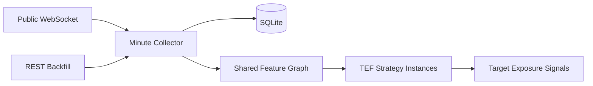

# AutoTradeMachine_Omega


[](./README.md)

---

### 📖 프로젝트 소개

**Auto Trade Machine Omega (ATM-Omega)**는 [ATM-Eta](https://github.com/kimlvis31/AutoTradeMachine_Eta)의 후속 프로젝트입니다. 기존의 **TEF (Target Exposure Factor)** 전략 인터페이스와 1분봉 데이터 기반을 계승하면서, 시장 데이터·분석·전략·계정 상태·거래소 통신·프로세스 제어의 경계를 다시 구성하고 있습니다.

장기적으로 **Build → Test → Execute** 흐름을 통해 전략 연구와 트레이딩을 연결하는 것이 목표입니다. 현재 저장소에는 코어 라이브러리, 공개 시장 데이터 수집기, 이관한 전략 계산식이 포함됩니다. 데스크톱 애플리케이션, 통합 실거래 런타임, 백테스팅 인터페이스는 아직 개발 중입니다.

#### 핵심 기능

- **실시간 시장 데이터 파이프라인** — Binance 현물·USD-M 선물의 확정 1분봉을 수집합니다. WebSocket과 REST 복구를 결합하고 순서·중복·누락·충돌을 처리합니다.
- **공유 다중 시간대 분석** — 동일한 1분봉 입력에서 상위 시간대의 종가를 집계합니다. feature 의존 그래프를 통해 여러 전략이 EMA/MMACD 계산을 공유하며, 미확정 상위 봉은 완료 상태를 갱신하지 않는 preview로 계산합니다.
- **TEF 전략 모듈** — 완성된 Eta 전략 계산식 6개를 이관하고 파라미터 검증과 인스턴스별 상태를 분리했습니다. 전략은 주문을 전송하지 않고 정규화된 목표 노출을 반환합니다.
- **거래소 어댑터 경계** — 현물·선물의 시장 데이터, 계정 조회, 일반 주문 기능을 분리했습니다. 다른 거래소를 추가할 때 전략이 거래소별 JSON 구조에 의존하지 않도록 인터페이스를 제공합니다.
- **거래 상태·복구 기반** — Decimal 회계, 체결 중복 제거, 자금 예약, 신규 진입 gate, 주문 의도 선행 기록, 결과가 불명확한 주문 상태를 다룹니다.
- **프로세스 격리 기반** — spawn 제어 프로세스 prototype과 크기가 제한된 JSON IPC를 구현했습니다. 전체 서비스 감독·재연결 구조는 이후 단계에서 연결합니다.

주문 변경 기능은 기본 비활성화 상태입니다. 공개 데이터 수집기는 계정 인증 정보를 읽거나 주문 어댑터를 생성하지 않습니다. 계정 대조·포지션 관리·실행을 연결하는 통합 실거래 런타임은 아직 완성되지 않았습니다.

---

### ▶️ 실행 방법

저장소를 내려받고 루트 디렉토리로 이동합니다.

```sh
git clone git@github.com:kimlvis31/atm-omega.git
cd atm-omega
```

#### Windows 🪟

```powershell
py -3.13 -m venv .venv
.venv/Scripts/python.exe -m pip install -e ".[streaming]"
.venv/Scripts/omega-collect.exe --market usdm --symbols BTCUSDT ETHUSDT --database data/usdm.sqlite
```

#### Linux 🐧

```sh
python3.13 -m venv .venv
.venv/bin/python -m pip install -e ".[streaming]"
.venv/bin/omega-collect --market usdm --symbols BTCUSDT ETHUSDT --database data/usdm.sqlite
```

현물은 `--market spot`으로 선택합니다. `--lookback-minutes`는 초기 과거 데이터 범위를 정하며 기본값은 500, 허용 범위는 1~20,000분입니다. 가상환경의 `omega-collect --help`로 전체 옵션을 확인할 수 있으며 **Ctrl+C**로 종료합니다.

수집기는 공개 API를 사용하고 지정한 SQLite DB에 저장합니다. API key나 Docker는 필요하지 않습니다. 한 번 실행할 때 하나의 시장과 최대 128개의 서로 다른 종목을 지정할 수 있습니다. 접속 가능 여부와 API 제한은 거래소·네트워크 환경의 영향을 받습니다.

---

### ✅ 요구 사항

| 구성 요소 | 요구 사항 |
| :--- | :--- |
| Python | CPython 3.13; 개발 도구 기준 버전은 3.13.16 |
| 운영체제 | Windows 또는 Linux; 전체 플랫폼 검증은 진행 중 |
| 런타임 | 코어/REST는 표준 라이브러리, 실시간 스트림에는 websockets 필요 |
| 저장소 | 선택한 SQLite DB를 기록할 수 있는 로컬 저장 공간 |
| 네트워크 | 데이터 수집 시 Binance 공개 REST·WebSocket 접속 가능 |

코어에는 GUI·GPU·신경망 프레임워크 의존성이 없습니다. 자원 사용량은 수집 종목과 소비자 수에 따라 달라지며, 운영 규모별 성능 기준은 아직 확정하지 않았습니다.

---

### 🧱 시스템 아키텍처

| 계층 | 역할 |
| :--- | :--- |
| `domain` | 거래 값, 회계, 자금 예약, 안전 gate |
| `ports` | 거래소·저장소·분석·전략·외부 모델 계약 |
| `application` | 주문 조정, 연속 1분봉 전달, 전략 실행 조정 |
| `analysis` | 공유 feature 그래프와 EMA/MMACD 계산 |
| `strategies` | TEF 모델, 파라미터 검증, 인스턴스별 계산 상태 |
| `infrastructure` | Binance REST/WS, 요청 예산, SQLite, JSONL |
| `runtime` | bootstrap 설정, IPC, 프로세스 수명, 수집 실행 진입점 |

도메인은 외부 구현을 import하지 않으며 분석·전략에는 broker 연결이 없습니다. application은 port에 의존하고 runtime이 구체적인 구현을 연결합니다.



봉 저장을 commit한 뒤 소비자에게 전달합니다. 누락된 분은 복구 전까지 이후 데이터 전달을 막고, 같은 시각의 확정 봉이 충돌하면 원본을 보존하고 오류를 알립니다. 사용할 수 없는 데이터를 임의로 0이나 보간 값으로 바꾸지 않습니다.

[config/master.config.example.toml](./config/master.config.example.toml)은 설정 loader가 지원하는 bootstrap 예제입니다. 공개 데이터 수집기는 별도의 CLI 옵션을 사용합니다.

---

### 🧠 TEF 전략 인터페이스

**TEF**는 `[-1.0, +1.0]` 범위의 목표 노출을 표현합니다. 부호는 방향, 크기는 상대 노출을 나타내며 자금 배분·상품 지원 범위·위험 관리는 전략 계산과 분리됩니다.

| 이관한 모델 | 분석 입력 |
| :--- | :--- |
| `MMACDDEFAULT` | MMACD |
| `BSCALPHA` | 상위 시간대 EMA·MMACD |
| `BSCBETA` | EMA, MMACD, DMI/ADX, MFI |
| `CGALPHA` | MMACD, DMI/ADX, MFI, PSAR, NES, WOI, 선택적 IVP 수준 |
| `PATHFINDER` | 시장 심리·단기 scalar |
| `SPDDEFAULT` | Swing 기준 가격·유형 |

6개 모델의 계산식 이관은 완료됐습니다. 공통 분석 생성기는 현재 EMA/MMACD를 지원하며 나머지 4개 모델에 필요한 추가 지표는 이관 중입니다. 필수 입력이 없으면 판단을 생성하지 않습니다. 미완성 Eta 모델인 `BSCDELTA`는 제외했습니다.

기존의 방향·크기 해석을 보존하면서 signed target으로 변환합니다. 정의되지 않은 계산을 만드는 파라미터를 거절하고 동일 입력이 tracker를 중복 진행시키지 않도록 처리합니다. 목표 노출은 주문 지시가 아니며, 예를 들어 음수 목표만으로 현물 공매도가 허용되는 것은 아닙니다.

---

### 🧪 개발·검증

가상환경에 운영체제별 고정 의존성을 설치합니다.

```powershell
# Windows
.venv/Scripts/python.exe -I -m pip --isolated install --require-hashes --only-binary=:all: -r requirements/dev-win-cp313.lock
.venv/Scripts/python.exe -I -m ruff check src tests
.venv/Scripts/python.exe -I -m ruff format --check src tests
.venv/Scripts/python.exe -I -m pytest -q
```

```sh
# Linux
.venv/bin/python -I -m pip --isolated install --require-hashes --only-binary=:all: -r requirements/dev-linux-cp313.lock
.venv/bin/python -I -m ruff check src tests
.venv/bin/python -I -m ruff format --check src tests
.venv/bin/python -I -m pytest -q
```

회계, 체결 중복, 주문 의도 내구성, 결과 불명 상태, 수집 복구, IPC, 설정, 계층 의존성을 검사합니다. 합성 기준 데이터로 TEF·EMA/MMACD를 Eta 계산과 비교하며 독립적인 경계 사례도 검증합니다. 테스트 중 외부 DNS·거래소 연결은 차단하고 Windows asyncio 내부 socketpair만 허용합니다.

GitHub Actions는 무료 사용 승인 조건을 갖춘 수동 Windows/Linux 검사로 구성됩니다. 로컬 검사는 hosted runner 없이 실행할 수 있습니다. 테스트 통과가 실거래 준비 완료나 수익성을 의미하지는 않습니다.

---

### 🔗 관련 프로젝트

- [AutoTradeMachine_Eta](https://github.com/kimlvis31/AutoTradeMachine_Eta) — 기존 트레이딩·분석 플랫폼.
- [TEFFPSeeker](https://github.com/kimlvis31/TEFFPSeeker) — 전략 파라미터 연구 프로젝트. GPU 연구를 후속 개발에 참고하며, 해당 엔진의 Omega 통합은 아직 구현하지 않았습니다.
