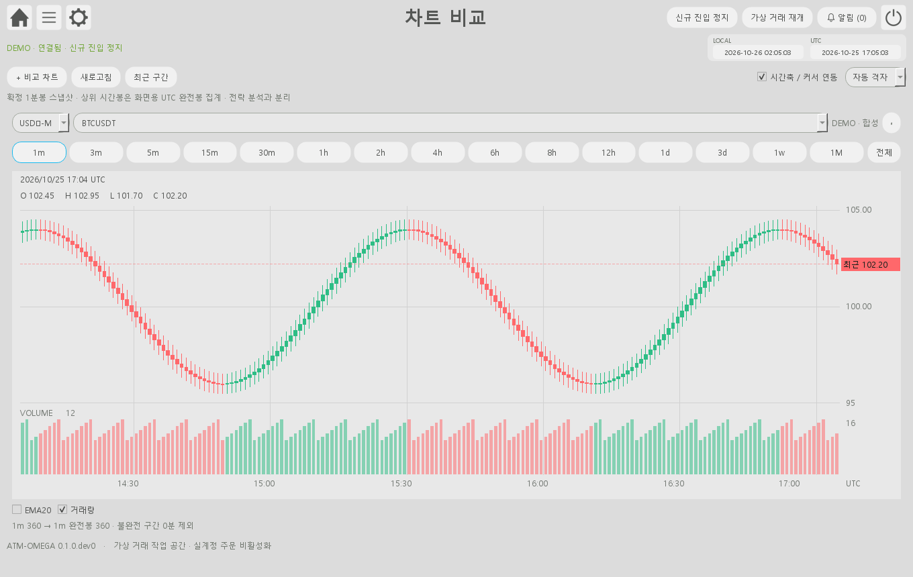
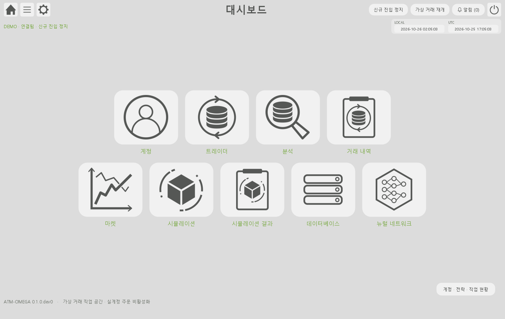
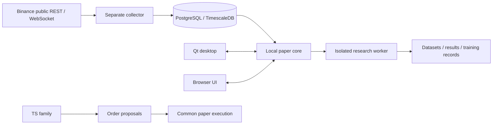

# AutoTradeMachine_Omega


[](./README.ko.md)



Eta-style independent Qt desktop — synthetic chart preview; real orders disabled.

Virtual margin history includes frozen-prefix pagination, UTC filters and an
atomic CSV/manifest ZIP export through the GUI or owner console. Startup NN
evidence budgets and cached usage are documented in the
[configuration guide](config/README.md#full-virtual-margin-ledger).



---

### 📖 Project Introduction

**Auto Trade Machine Omega (ATM-Omega)** is the successor to [ATM-Eta](https://github.com/kimlvis31/AutoTradeMachine_Eta). It carries forward Eta's one-minute market-data foundation and TEF calculations while separating strategies, accounting, exchange adapters, research workers, and the desktop interface.

The current **early integration release** connects a local paper core, an optional independent Qt desktop, public Binance data collection, and offline research jobs. The goal remains **Build → Test → Execute**. Trained models support explicitly activated CPU shadow inference and a separate committed-input path into opt-in virtual strategies. Live account execution remains disabled. This release does not place real exchange orders.

#### Core Capabilities

| Area | Available now | Current boundary |
| :--- | :--- | :--- |
| Market data | Binance Spot/USD-M closed 1-minute candles; WebSocket + REST recovery; PostgreSQL/TimescaleDB; opt-in committed-candle delivery to paper | Separate collectors and manual restart; paper delivery requires warmup, fresh contiguous data and explicit setup |
| Analysis | Shared aggregation, moving averages/bands and causal indicator producers; saved templates, instrument instances and independent committed-DB execution | Frozen strategy snapshots; explicit live depth has coverage gates; historical depth is unavailable; auxiliary strategies require explicit collection and valid coverage |
| Trade Strategy (TS) | Manifest registry, common order-proposal contract, `tef`, `target_quantity` and demonstration `neural_signal` families, offline validator | TEF exposure is internal to TEF; live execution integration is unfinished |
| Paper accounts | Existing v1 accounts plus opt-in margin v2 TS sessions with cross/isolated collateral, durable intents, next-bar fills, scenario funding and optional fixed slippage/delay assumptions shared with replay | V1 remains at leverage 1. V2 uses OHLCV proxy marks, full fills and explicit brackets; costs/funding are scenario assumptions, not venue execution/payments. No liquidation, partial fills or price impact. V2 supports frozen native trade-flow, depth and metric inputs for auxiliary-aware TS graphs; coverage and numerical warmup remain required |
| Desktop | Independent Qt pages, Eta dashboard, collapsible panels, structured TS/analysis settings, comparative charts, fill history, DB controls, research and result viewers | Full Eta reporting parity remains unfinished; audible notification validation is pending |
| Research | Dataset snapshots/splits, seeded Monte Carlo, CPU replay, external Python NN training and records | No GPU simulation backend, full Eta execution parity, or live account execution |
| Mobile | Responsive browser UI, device registration/revocation, cached v1/v2 virtual positions and read/pause/resume permissions; installable public PWA shell where supported; explicit trusted HTTPS proxy origin and opt-in Web Push sender | Core stays loopback-bound. A private HTTPS proxy must be configured separately; physical-phone/external connection setup and background push remain unverified. Offline state is unavailable, never a cached financial account |

Open `/mobile/` on the local core URL and enter a pairing code issued by the owner.
The page separates v1 positions from cached margin v2 positions and their consumed
minute, account gate and pending-order count. Unknown or disconnected data never
confirms an empty portfolio. Entry pause retains submitted orders; global resume
does not release an account's separate session, feed or recovery pause. Supported
browsers can install the public shell from the browser menu. The service worker
caches allowlisted static assets only, never account state, tokens or commands;
there is no offline trading or automatic command replay. The current loopback
server is accessible on this PC, not directly from a physical phone over LAN.
Physical-device HTTPS/private-network setup and actual notification delivery require
separate verification; an installable shell is not a native Android/iOS package.

**Optional private HTTPS proxy:** `mobile.https_origin` defaults to an empty value,
which disables every non-loopback Host/Origin. In Runtime settings, or through the
core console (`set mobile.https_origin "https://omega.private.example"`), explicitly
set the exact HTTPS origin of a separately managed, trusted private reverse proxy.
Use an origin without a trailing slash, path, credentials, query or fragment;
hostnames must already be lowercase ASCII. Only that exact origin is added.
The core continues listening on `127.0.0.1`; it ignores forwarded headers and
keeps its existing device pairing, permissions and owner-token authentication.
The device registration page displays the `/mobile/` address without a token.
Clear the setting to remove proxy access immediately. Configure the proxy's TLS,
private-network access and local upstream separately; do not expose the core
directly or remove its authentication. This adds no Omega-hosted relay server,
VPN installation or native app. Physical Android/iOS and an
actual external proxy still require separate verification.

**Optional mobile Web Push (default OFF):** after configuring the private HTTPS
origin above, install the optional `push` extra in the Core environment and start
the Core with `--web-push --push-subject <your-contact-URI>`. The contact must be
your HTTPS host without a path, or your `mailto:` address; there is no invented
default contact. Keep it outside public screenshots if it is personal. This is a
local owner startup choice, not a phone trading permission. Missing dependencies,
HTTPS configuration or a valid contact leave push unavailable while the Core's
local alarms and position protection continue independently. Starting without
`--web-push` disables the sender and does not import encryption dependencies or
generate a push key. `--help` also remains usable without the optional extra.

Explicit enablement creates a distinct P-256 VAPID key at
`secrets/vapid-private.pem`. Subscription credentials and bounded deduplication
metadata live separately at `secrets/push-subscriptions.json`. Both remain local,
excluded from Git; do not put them in diagnostics or share them. Restrict the
`secrets` directory to the Core owner using OS file permissions (Windows inherits
the directory ACL). The key persists across Core restarts; replacing it requires
phones to disable and register their subscriptions again. The optional extra pins
the sender version; release preparation must also resolve, hash and review its
transitive dependency set before installation or distribution.

On the paired phone, use **이 기기에서 알림 받기** to explicitly request browser
permission and register a subscription. iOS requires a supported Home Screen web
app; Android requires a browser supporting Push API. The public key alone is
exposed to authenticated read devices. Registrations expire after at most30days;
use **알림 구독 갱신** to renew. **이 기기 알림 끄기** stops new Core submissions
before removing the local browser subscription. Browser permission loss is
reconciled when this page reconnects; owner device revocation stops new submissions
without waiting for the page. Closing the tab or **연결 해제** clears its existing
session credential but does not itself revoke the separately enrolled push
subscription. Already submitted remote notifications cannot be recalled.

Push payloads contain only an opaque incident ID, severity and time. Opening a
notification opens the fixed `/mobile/` page; it does not acknowledge an incident,
pause, resume or submit an order. Only explicitly reviewed Google, Mozilla and
Apple HTTPS provider hosts and endpoint paths are enabled; an unknown provider
requires review rather than a broader URL allowance. Delivery is best effort:
`accepted_by_service` means HTTP201, not arrival on a phone or user acknowledgment.
`attempt_unknown` after a timeout is not automatically resent. Explicit503/429
responses get at most two bounded retries. One bounded worker and fair per-device
queue cannot block financial handlers; TTL may expire during congestion. A stopped
or offline PC cannot originate a new outage warning. Browser/OS permission, Focus,
battery behavior, locked screen, proxy reconnect and PC/network loss still need
explicit physical-device checks. No always-on Omega relay is added; browser-vendor
services and private-network connectivity remain external dependencies.

An experimental owner-only CPU NN shadow workflow freezes a trained candidate, verifies a fixture in an independent research child, and requires explicit activation. It accepts prepared numeric batches or explicit retrospective raw OHLCV windows with module-owned preprocessing. Predictions are inspectable through the Neural Network page and terminal/API; shadow results are separate from the explicitly bound committed-input TS path. Restart pauses the shadow stream and requires manual reset/resume.

The Neural Network page also has a separate, initially collapsed **committed
inference** panel. Select a completed training job, explicitly trust its module,
confirm its tensor/output contract, activate and reset a stream, then request an
actual stored closed minute. The core verifies PostgreSQL input availability and
runs preprocessing/prediction in a reusable CPU child. Features become visible
after durable result/state acknowledgement and expire at their deadline. A valid
NoSignal keeps the recurrent cursor without publishing a feature. Unknown
dispatch/state requires an explicit fresh reset. Restart requires manual recovery.
The Virtual margin v2 page can explicitly bind a registered stream to the
`neural_signal` quantity demo. Exact candle/model/epoch/TTL proofs and durable
financial pins guard new entries; unavailable signals leave accepted orders and
the module's independent local protection active. A late result cannot rewrite
a consumed minute. The console shortcut is `causal-inference`; see the
[owner API manual](config/README.md#committed-inference-owner-api).

The GUI uses authenticated local HTTP and can close or reconnect independently of the core. GUI autostart defaults to `false`. The core starts paused, and restarting it requires manual resume. Pausing new entries preserves submitted orders. Exchange conditional protection orders are not used.

---

### ▶️ How To Run

See the [configuration and terminal manual](./config/README.md) for the core input console,
separate log window, every runtime preference, and GUI-free API workflows.

Clone the repository and enter its root:

```sh
git clone git@github.com:kimlvis31/atm-omega.git
cd atm-omega
```

#### Windows 🪟

```powershell
.\setup.bat --gui
.\run.bat
# Select 3 for an explicit synthetic chart preview.
```

#### Linux 🐧

```sh
bash ./setup.sh --gui
bash ./run.sh
# Select 3 for an explicit synthetic chart preview.
```

Linux Qt also needs system graphics, font and desktop libraries. The Debian-based offscreen test image uses `libgssapi-krb5-2`, `libxcb-cursor0`, `libegl1`, `libgl1`, `libxkbcommon0`, `libdbus-1-3`, `libfontconfig1`, `libglib2.0-0` and `fonts-noto-cjk`. Package names vary by distribution; see [Qt's Linux requirements](https://doc.qt.io/qt-6/linux-requirements.html). Setup installs Python wheels, not OS packages.

With an interactive terminal, `run` stays open as a menu: **1** opens/attaches the GUI, **2** starts the foreground core, **3** starts a background demo core and opens the GUI, and **0** exits the menu. An existing core is reused without changing its data source. Closing the GUI or the menu leaves the core running; preview mode reports its PID and launcher log directory. For a core you can stop with **Ctrl+C**, use `core.bat --demo` (Linux: `bash core.sh --demo`) and `gui.bat` / `bash gui.sh` in a second terminal. Command arguments and redirected input retain noninteractive CLI behavior.

`--demo` explicitly enables synthetic chart data and creates `data/demo-candles.csv` if absent. This is sample data, not an exchange feed. The CSV can be selected as the source for dataset export in the desktop research page. Starting the demo does not automatically create an account, run a strategy or train a model.

Without `--demo`, the chart reads database snapshots and reports unavailable data when the database is not ready. Chart display does not enable strategy execution. The Trading page offers manual closed-candle input or an explicitly enabled database feed. The feed prepares indicators without trading, then processes committed closed one-minute frames with gap/staleness checks and a shared frame barrier. Data-only recovery clears its own gate; user pause and restart recovery still require their respective controls. This is paper execution, not live exchange trading. A separate experimental `run.bat margin --help` / `bash run.sh margin --help` console runs explicitly supplied USDM cross/isolated scenarios with a durable intent/fill journal. It is separate from the opt-in Virtual margin v2 page, which connects TS modules to committed database minutes and durable cross/isolated accounting. Existing leverage-1 accounts are not converted; see the configuration manual and supplied `config/examples/margin-*.json` files.

Existing v1 paper accounts use USDT and accept Binance USDT-quoted Spot/USD-M instruments. The separate margin v2 host accepts USDT-quoted USD-M instruments. Research replay can specify another quote asset with explicit instrument metadata, but rejects mixed quote currencies in one wallet. These paths do not perform FX conversion.

#### Desktop workflows

The power menu separates **Close GUI** from **Stop core**. Core shutdown offers
save-and-exit (explicitly acknowledging that local position management stops),
cancel, or flatten-and-exit. Flattening waits for confirmed fills; paper v1 and
cross/isolated margin v2 use the next eligible market minute rather than an
invented immediate fill. All account owners must pass preflight before it starts.
Financial uncertainty blocks completion; a failed strategy model does not disable
the separate financial drain. Cancel preserves submitted reduction orders and
leaves new entries paused.
Restart always requires manual strategy recovery. An interrupted connection is
not an exit confirmation: query the original request ID after reconnecting.

The owner terminal provides `shutdown status`, `shutdown review`, `shutdown save`,
`shutdown flatten`, and `shutdown cancel`; `help` lists commands. In the core's
interactive terminal, `exit` opens the same three choices. A forced OS stop or a
closed terminal does not perform an automatic flatten.

The light gray/lime theme, original Eta icons and 4+5 dashboard layout preserve Eta's visual direction. Home, page title and boxed LOCAL/UTC clocks remain visible; the menu exposes additional pages. Pause/resume controls stay at the top, and account/strategy/job details can be expanded when needed. Saved theme/language preferences take precedence over the light default.

- **Charts:** compare up to six instruments with linked time/cursor, fixed candle selection, independent price/volume scales, optional EMA20 and fifteen intervals from 1m to calendar weeks/months. Click an area before using the wheel: plot zooms time, time axis pans, and value axes ignore the wheel. Drag the plot to pan, the time axis to zoom horizontally, or a value axis to scale vertically; right-click a plot to fit its value range. Higher intervals require complete contiguous UTC groups. Chart aggregation does not change strategy inputs. Chart settings offer three slots with unique VOL/MFI/MMACD/DMIxADX assignment, separate calculation/display switches, named profiles and an explicitly saved six-pane workspace. DMI uses the common core producer on committed DB minutes for supported 1m–1d periods, with retrospective knowledge timestamps and explicit warmup gaps; display-type changes reuse its results. Old profiles migrate in memory and Save is explicit. Display timezone changes leave UTC data unchanged. Paper trade markers come from the selected real paper-fill history, not synthetic exchange fills.
- **Analysis:** save/clone templates, create instrument-bound instances and edit EMA/MMACD/SMA/WMA/BOL/MFI/DMIxADX/SWING/PSAR/NES/WOI/MST/STS/TPD/IVP with structured fields. Start/stop an independent CA against committed database minutes, inspect warmup/quality/results, and manually resume after core restart. NES/MST can consume committed trade-flow/native-statistics inputs with source revisions, availability cutoffs and quality/age checks. Durable input manifests preserve the inputs of interrupted chunks; missing inputs block progress. The Database page provides an explicit continuous trade-flow/native-statistics subscription. DB-fed v1 paper strategies consume fixed selected inputs, preserve prior orders and candle protection during auxiliary gaps, and gate new risk on readiness. Live depth can supply WOI/STS when stream continuity and the required book range are observed; partial/missing inputs remain gated and historical depth cannot be manufactured. Strategy bindings retain frozen snapshots. IVP interprets OHLCV ranges rather than actual trade-price volume and needs `setup.bat --analysis` / `bash setup.sh --analysis`.
- **Trading/history:** select an account/strategy, edit manifest-defined fields, choose a saved analysis instance and configure optional database delivery. Advanced JSON remains available. Percentage inputs retain exact ratios; recorded fills and fees retain their currencies. Full Eta protection/reentry and execution subscription parity remain unfinished.
- **Simulation Results:** inspect completed replay summaries, equity/drawdown, fills, events and assumptions. Copy a recorded configuration into a new setup draft without automatically running it.
- **Database:** use the initially collapsed continuous auxiliary panel to preview strategy demand, apply subscriptions, stop collection or resume an uncertain task. Requested collection does not mean its data is ready, and core restart requires explicit reapplication. Select Spot or USD-M, filter/select symbols, set NONE/STREAM/ALL collection, inspect stored coverage and internal gaps, refetch missing observations, or import missing candles from a local-network peer. Narrow windows move the same controls into three tabs while preserving selection.

In **Charts → a chart's Settings → Price overlays**, SMA, WMA and BOL each provide ten indexed lines. Family enable, line calculation and line visibility are separate; the new families start disabled. BOL selects SMA/WMA/EMA for its center and controls the center/band separately, preserving zero or negative deviation multipliers. Apply changes the current view; named profile Save and Save layout persist it. Old profiles migrate in memory until explicitly saved.

**Chart settings → WOI / MST / STS** connects the existing analysis providers to the same three indicator slots. WOI and MST each support ten calculated lines with independent visibility and styling; STS displays S/M/F/D/W as a signed histogram. These families start disabled. WOI/STS require stored depth observations; MST requires trade flow and fresh native futures statistics, and is unavailable for Spot. Missing inputs remain gaps, while valid inputs can still be warming up. Changing a displayed field, style or slot reuses the calculated result. An empty origin anchors once to 128 complete bars; use the explicit anchor control to choose a new window. Large requests can stop at the calculation or result-size limit with an actionable message. Existing profiles retain their format until a new-family setting is changed; Apply is temporary and Save is explicit.

After eight consecutive unconfirmed chart requests, automatic lookup pauses. **Check same request** makes one lookup without submitting another calculation. A confirmed pending response resumes polling; changing colors, language or reconnecting does not reset this limit.

These overlays use one batched core request and the common producers on committed one-minute database candles, for 1m–1d periods. After first enabling them or reconnecting to a new core, use **Refresh source** to obtain verified original data. Demo and calendar periods are unsupported. Each pane keeps a fixed replay origin, with at most10,000minutes per snapshot; leave the advanced UTC-millisecond origin blank to fix it to the pane's first verified minute, or explicitly choose a new origin when the range limit is reached. Warmup and missing data stay distinct. Exact original candle content and the serving core must match the result. Color, visibility and band/center display changes reuse the existing values. These are retrospective displays, not historical trading signals.

Chart settings also provide default-off PSAR dashes and SWING price overlays from the common core producers. SWING connects only pivots confirmed by the fixed selected candle's close; clearing selection hides it, and gaps are not connected. These are retrospective displays, not a claim about data known at each historical close.

The three indicator slots also offer default-off stored OI, long/short ratio,
trade flow, depth quote-notional totals and funding observations. Source, metric,
unit and gaps remain explicit; isolated observations are dots rather than lines
across missing minutes. Only complete UTC buckets are displayed. Calendar and
over-10,000-minute auxiliary requests are unsupported. The depth view sums stored
bid/ask quote notionals; it is not an order-book heatmap. History has separate v1
and margin-v2 views; the latter reads the recorded ledger without recalculating PnL.

Database controls use the authenticated core API; the GUI does not connect to PostgreSQL directly. LAN imports read an **Omega v2** peer using a literal private/loopback IP and a read-only transaction, preserve existing local observations, and never persist the peer password. Eta databases need a separate migration adapter. Gap repair restores actual observations; interpolation and Monte Carlo stay in research datasets. Coverage refers to first-to-last stored observations, and the detailed range list is bounded to the latest 20,000 minutes. Separate auxiliary and Depth panels collect public trade flow, native statistics and live books; historical depth, GUI compression/reset controls and collection ETA remain unavailable. Configured collection is not a guarantee that a worker is ready, and collectors require manual restart after a core restart.

#### Collect public market data

Docker Engine/Compose (Docker Desktop on Windows) must be running for database commands. No exchange API key is needed.

For a fresh installation, choose another local port with `run.bat db init --port 54328` or `bash run.sh db init --port 54328`. `db configure --port 54328` prepares the files without starting Docker. Initialization uses the port and database name in `database.config.toml` for both Compose and the application connection. Windows may reserve the default port; choose an available port explicitly.

An existing different port is never overwritten by `--port`. To change it, stop the Core, collectors and database, edit `port` in `database.config.toml`, then run `db init` again. Existing credentials and the persistent volume are preserved; changing a port does not reset stored data.

```powershell
# Windows
.\run.bat db init
.\run.bat collect --market usdm --symbols BTCUSDT ETHUSDT --db-config database.config.toml
```

```sh
# Linux
bash ./run.sh db init
bash ./run.sh collect --market usdm --symbols BTCUSDT ETHUSDT --db-config database.config.toml
```

Use `--market spot` for Spot. Each collector invocation supports one market and up to 128 unique symbols. `--lookback-minutes` defaults to 500 and accepts 1–20,000. Use `run.bat collect --help` or `bash run.sh collect --help` for options.

**Optional original REST capture (default OFF):** for Core-owned collectors and
manual REST gap refetch, set the existing `master.config.toml` collection section
before starting the Core:

```toml
[collection]
capture_rest_raw = true
```

The example configuration keeps this `false`. The Core stores captured page bodies
and receipts under `[paths].data_dir/raw/candles` (`./data/raw/candles` by default,
relative to the Omega root). Standalone `collect` uses its own explicit flags and
does not read this startup setting:

```powershell
.\run.bat collect --market usdm --symbols BTCUSDT --db-config database.config.toml --capture-rest-raw --raw-directory data/raw/candles
```

```sh
bash ./run.sh collect --market spot --symbols BTCUSDT --db-config database.config.toml --capture-rest-raw --raw-directory data/raw/candles
```

For standalone collection, omitting `--raw-directory` chooses `data/raw/candles`
beneath the database configuration file's directory; an explicit relative directory
uses the collector's working directory. `--raw-directory` requires
`--capture-rest-raw`. Omitting the capture flag retains the legacy normalized REST
path and creates no REST archive.

Capture stores the actual HTTP response **entity-body bytes**, with their receipt
time, request window, instrument and content hash. It does not capture TCP/TLS
packets. Each accepted minute also retains its exact original UTF-8 JSON row
fragment in PostgreSQL, including numeric spelling and escaping, with
`source="rest"`, `raw_source="rest"` and the original `raw_received_at_ms`.
Canonical acceptance time is separate and is sampled after the response is
processed; no timestamp is clamped or reconstructed from candle close time.
Whole pages are limited to 8MiB, row fragments to 64KiB. Pages are stored by content hash;
the archive, per-response receipts and database raw text still consume additional
disk space. These are per-record limits, not a total storage quota; there is no
automatic archive deletion or retention cleanup.

With capture enabled, archive failure, missing actual receipt or an invalid/oversized
capture prevents that REST read from publishing new observations; it is reported
as a collection/refetch failure. Previously committed observations remain. This
option records responses fetched while enabled: it neither enriches existing
rows without raw payloads nor recovers discarded historical responses. A later fetch would
be a new response with a new receipt. Raw export continues marking unavailable
legacy payloads and never recreates them from normalized OHLCV.

#### Export stored observations and check TS modules

```powershell
.\run.bat export --instrument binance:usdm:BTCUSDT --output data/BTCUSDT.csv
.\run.bat export --instrument binance:usdm:BTCUSDT --output data/BTCUSDT-raw.jsonl --raw
.\check_ts.bat
.\check_ts.bat tef
.\check_ts.bat target_quantity --json
```

On Linux, use `bash ./run.sh export ...` and `bash ./check_ts.sh ...` with the same arguments. Export reads the latest committed PostgreSQL observations, defaults to 10,000 rows, and refuses to overwrite an existing output file. CSV contains normalized OHLCV; `--raw` writes stored received payloads and their availability to JSONL. Missing raw payloads are marked, never reconstructed from OHLCV. Raw export JSONL is an inspection record, not the normalized research dataset input.

With no module argument, `check_ts` lists detected families and prompts for a selection. `--list` reads manifests without importing module code. The validator checks initial offline conformance and family cases; it does not establish full accounting/recovery coverage or trading readiness. External TS execution requires explicit trust (`--allow-external` for validation, `--trust-ts` for the core): selected Python code runs with your user permissions.

#### Installation options

Setup requires an installed **CPython 3.13**, creates/reuses the repository's `.venv`, installs hash-checked dependencies and the local package, and checks dependency consistency. It creates local database configuration and random credentials under `secrets/` without overwriting existing files. It does not start Docker, the collector or the core.

- Default setup installs runtime/build dependencies. Add `--gui` for Qt or `--dev` for development tools. Select either `--neural-cpu` for optional hash-locked CPU PyTorch examples or `--neural-cuda` for CUDA 12.6 PyTorch on Windows x86-64 CPython 3.13 only. CPU and CUDA options are mutually exclusive; either can accompany GUI/development options. NN wheels are large optional downloads and are not installed by default. CUDA setup acquires the exact official Torch wheel with its pinned hash, then installs the remaining pinned dependencies from PyPI; `--wheelhouse` uses local wheels only. It does not install a GPU driver or select a research device.
- `OMEGA_PYTHON` selects an installed Python executable. `--wheelhouse /path/to/wheels` supports offline installation when all required wheels are present.
- Re-running setup reuses the environment. An explicit `setup.bat --neural-cuda` upgrades the project `.venv` to the pinned CUDA Torch variant; use a separate checkout or move the existing `.venv` aside explicitly to retain a CPU environment. Move an incompatible/incomplete `.venv` aside explicitly. Linux may require the distribution's Python 3.13 venv support package.
- Optional GUI dependencies are PySide6 Essentials/Addons and shiboken6 **6.12.0**. The GUI uses QtWidgets/QtNetwork and does not require QtWebEngine.
- `--speech` also installs the Qt dependencies for optional core-owned speech alerts without enabling GUI autostart. Settings control speech language, installed voice, rate and volume; unavailable voices are reported explicitly. `console.bat` / `console.sh` and `logs.bat` / `logs.sh` provide separate input/response and log views.

---

### ✅ Requirements & Storage

| Component | Requirement |
| :--- | :--- |
| Python | CPython 3.13; exact development version is in [`.python-version`](./.python-version) |
| Operating system | Windows or Linux; complete cross-platform validation is in progress |
| Runtime | Standard-library core/REST, `websockets`, Psycopg 3 |
| Optional desktop | Qt dependencies installed with `setup --gui` |
| Market storage | Docker Compose, PostgreSQL 18 + TimescaleDB 2.31, persistent local volume |
| Collection network | Binance public REST/WebSocket access |
| NN frameworks | Supplied by the chosen external model; not required to start the core/GUI |

The database binds to `127.0.0.1:55432` by default, uses a digest-pinned image and a non-superuser collection account, and does not restart at boot. `run.bat db status` / `bash run.sh db status` checks readiness; `db stop` preserves the volume. Existing Eta databases are not opened or migrated automatically. Market storage is PostgreSQL/TimescaleDB; SQLite is not a substitute. Maintenance/compression is separate from ingestion transactions.

The synthetic demo and file-based research do not need a running market database. CPU/RAM requirements depend on instruments, charts and research workloads; long-running capacity benchmarks have not been established.

---

### 🧱 System Architecture

| Layer | Responsibility |
| :--- | :--- |
| `domain` / `ports` | Trading values, accounting, safety rules and implementation-independent contracts |
| `application` | Common order coordination, reservations, paper execution and candle delivery |
| `analysis` | Shared feature graph and indicator producers |
| `strategies` | TS registry, TEF family policies, independent quantity-target family |
| `infrastructure` | Binance REST/WS, request budgets, PostgreSQL/TimescaleDB and durable records |
| `runtime` | Composition, authenticated loopback API, controls, settings, notifications and CLI |
| `research` | Dataset lineage, Monte Carlo, CPU simulation, NN host and isolated jobs |
| `gui` / `mobile` | Independent desktop client and initial browser device interface |



Candles commit before downstream notification. Gaps block ordered delivery until recovery; conflicting candles preserve the original and surface an error. Missing data is not silently replaced with zero or interpolated. [Master configuration example](./config/master.config.example.toml) covers bootstrap settings; the collector has separate CLI options.

---

### 🧠 Trade Strategy Families & TEF

The shared TS contract receives market/account views and returns `TradeDecision` containing `OrderProposal` values. Common execution, accounting and risk code do not require normalized exposure. Installed families are `tef`, `target_quantity` and demonstration `neural_signal`; quantity targets and NN interpretation remain separate from TEF exposure. The registry discovers manifests, validates contracts and creates instances.

**TEF (Target Exposure Factor)** is one TS family. Its six internal calculation models are not six separate TS families. TEF owns exposure interpretation, allocation/entry, resize/reversal and local protection/reentry policy; common execution validates proposals and maintains accounting. These local policies do not create exchange conditional protection orders.

| TEF model | Analysis inputs | Provider and data requirements |
| :--- | :--- | :--- |
| `MMACDDEFAULT` | MMACD | Installed provider |
| `BSCALPHA` | Higher-interval EMA/MMACD | Installed providers |
| `BSCBETA` | EMA/MMACD, MFI, DMI/ADX | Installed providers |
| `CGALPHA` | MMACD, MFI, DMI/ADX, PSAR, NES, WOI; optional IVP | Installed providers; requires valid trade-flow/depth coverage and warmup |
| `PATHFINDER` | Market sentiment (MST), short-term scalar (STS) | Installed providers; requires valid trade-flow/native-statistics/depth coverage and warmup |
| `SPDDEFAULT` | Swing reference price/type (SWING) | Installed provider; waits for a confirmed swing |

All six formulas have frozen synthetic legacy comparison coverage, including CG/PATH/SPD. NES/WOI/MST/STS/IVP provide independent producers and checkpoint checks. Public trade-flow, native OI/long-short samples and explicitly collected live depth can be archived and committed to the database. Independent CA and the auxiliary-aware v1 DB feed consume supported inputs with fixed source revisions and coverage gates. Collection is opt-in; a formula or installed provider alone does not make a strategy ready. Initial depth minutes may be partial or missing depending on provider-clock alignment, and historical depth is unavailable. SWING publishes a pivot with its confirmation availability, so a strategy cannot use it before confirmation. Unsupported required fields are rejected explicitly. The unfinished Eta model `BSCDELTA` is excluded. Paper v1 models full fills at leverage 1, with orders first eligible on the next one-minute candle; it has no partial fills, liquidation or funding model. The opt-in margin v2 TS host supports cross/isolated leverage separately. OHLCV-only sessions retain their previous behavior.

Automatic v2 sessions can supply committed `trade_flow`, explicitly collected depth and native OI/long-short samples to NES/WOI/MST/STS analysis graphs. Complete CGALPHA/PATHFINDER analysis configurations can be bound; this is not a claim of fully warmed built-in trading parity. The configured MST sample-age policy, original source revisions, availability cutoff and database identity are frozen across retries and restarts. OHLCV-only sessions retain their existing behavior. Auxiliary-aware TS modules require an independent protection method: missing, partial, stale or warming-up inputs restrict new entries while accepted orders and local TEF protection continue. Accepted orders remain subject to their original execution and risk bounds. Native auxiliary research replay uses an explicit observation bundle version: V1 retains trade-flow-only replay; V2 can retain original flow, depth and sparse metrics. Select the matching supported mode in the research setup.

To use a saved analysis configuration, save its template and instrument-bound CA in **Analysis**. In **Virtual margin v2**, use **Copy saved CA analysis → Refresh**, select the matching CA and **Apply selection** before adding the strategy. Review the full copied settings and register the virtual account, which starts paused. Explicitly apply the required Database auxiliary/depth subscriptions and inspect readiness before requesting resume. The copy does not run the CA or update an existing strategy automatically.

For each new virtual-margin or shared-margin research strategy, **Execute required indicators only** optionally selects its actual analysis dependencies while preserving the full saved CA. It starts OFF and requires a supporting core plus a validated typed profile. See the [per-strategy execution policy](config/README.md#execute-only-a-strategys-required-analysis).

The database stores closed one-minute candles. Higher intervals are derived from those observations, with week/month charts queried at UTC calendar boundaries in the database. Charts display complete groups and separately report gaps or unfinished periods. Auxiliary channels distinguish summed trades, depth snapshots and actual metric observation times; missing observations never become valid zero values.

Database → Auxiliary collection provides bounded trade-flow and native OI/long-short jobs, with cancellation, manual resume and archived original responses. A completed statistics job means its received batch was stored; it does not establish coverage of the whole requested range. For a partial trade-flow job, select a reported incomplete minute and explicitly create a repair job. Repair appends an observed revision only when real boundary evidence is sufficient, preserves the original revision and availability, and uses a separate attempt ID. Resuming an existing attempt replays its frozen records without automatically fetching more data.

---

### 🔬 Research & Neural Networks

The desktop submits dataset export, Monte Carlo, simulation, training and module-inspection jobs to an independent research worker. Closing the GUI does not cancel those jobs. Dataset input is normalized CSV/JSONL with `instrument,open_time_ms,open,high,low,close,volume`; an instrument key looks like `binance:usdm:BTCUSDT`.

Dataset snapshots retain source bytes/hashes, chronological train/validation/test splits and quality information. Monte Carlo transforms blocks within selected splits, defaults to training only, records seeds/source timestamps and preserves the original. It produces derived datasets for replay/training. It does not replace the original exchange observations.

Dataset export optionally accepts `interpolation: {enabled: true, method: "linear_close_flat", max_gap_bars: 5, max_ratio: 0.05}` in its job parameters. Methods are `linear_close_flat` and `previous_close_flat`; interpolation is disabled by default. Repair stays inside each frozen split and preserves original data alongside a separate variant, synthetic-row mask, quality/rate records and unresolved-gap ranges. Inserted rows use flat OHLC and zero volume as placeholders, not observed prices or evidence of zero trading. `linear_close_flat` uses a future anchor and is **noncausal**: simulation rejects such repaired input by default. Only explicit `allow_noncausal_research_input: true` permits offline stress replay, with a warning that it is not a causal historical backtest.

CPU replay supports common TS binding, next-minute order activation, intraminute path assumptions and configurable costs/latency. It is an unleveraged reference model, without liquidation, order-book depth or partial fills. GPU/Triton simulation and full Eta execution parity are unfinished. GPU requests for simulation are reported as an explicit CPU fallback.

Simulation setup also offers an explicit **shared margin v2** mode. It reuses the
virtual account's cross/isolated session, intents, fills and accounting, with CPU
closed-minute proxy execution and fees. Its structured account/strategy settings,
ledger, assumptions and copyable result draft are separate from the unleveraged
path/cost model. An optional versioned rate schedule adds scenario funding through
the same conserved virtual ledger, with signed cashflows and source/availability
records. It does not import actual venue account payments. An opt-in verification
policy applies fixed adverse slippage and separate entry/reduction delays through
the same reserved intents and frozen fill facts. No-policy retains the previous
strict model. These are minute-based scenarios, not measured venue latency.
Liquidation, partial fills, price impact and GPU execution remain unsupported.
See [funding](config/README.md#scenario-funding-in-virtual-margin-and-shared-replay)
and [execution-cost configuration](config/README.md#shared-margin-execution-cost-policy).

For optional stored auxiliary inputs, inspect an existing OHLCV dataset in the
research page and choose explicit instrument/channel/source selections. The default
V1 observation bundle retains its existing NN preprocessing and joint Monte Carlo
workflow. Original data, transformations and lineage remain separate; depth and
unknown-unit Monte Carlo are unsupported.

Choose **Bundle format → V2** to export original trade-flow, collected depth and
native USD-M OI/long-short observations for **shared margin v2 → Native original
observations** replay. V2 preserves retained revision chains, actual event and
availability times, source ranges, and depth sampling/coverage metadata. Missing
and partial observations remain explicit; exporting neither collects data nor
fills gaps. Selected sources remain declared even when no samples are available.
The bounds are eight source selections, 10,000 requested source-minute slots and
retained records, and a 32 MiB observation file. OI/long-short selections require
an explicit metric lookback from zero to one day; zero retains no pre-candle seed.
Choose enough lookback for the strategy's sample-age policy: replay rejects a
policy exceeding that retained coverage instead of fetching additional history.

V1 native replay remains trade-flow-only. V2 native replay supports the original
flow/depth/sparse-metric inputs used by NES/WOI/MST/STS through the same virtual
margin engine. Select decision latency explicitly; original revisions, availability
cutoffs and next-minute order eligibility remain enforced. This does not establish
default-parameter CGALPHA/PATHFINDER parity. V2 is not accepted by NN training,
Monte Carlo or plain OHLCV replay, and cannot be silently converted into V1.
Funding remains a separate explicit scenario policy rather than a V2 observation
channel. Historical REST samples keep their actual download availability: exporting
later cannot make them known at an earlier candle close. Generated/MC/proxy data
cannot become native evidence or live inference readiness.

Simulation `spec.path` accepts `O-H-L-C`, `O-L-H-C` or seeded `random`. Deterministic `spec.routes` can override `bullish`, `bearish` and `doji` cases. Without an explicit fallback `path`, all three cases are required; partial routes require that fallback. Random paths and deterministic routes cannot be combined. Empty routes retain the global path preference. The reserved `conservative` preference currently rejects a job unless an explicit supported path or complete case routes are chosen.

External NN `.py` modules implement `describe()/create()` and instance `prepare/transform/train/evaluate/save/close` methods. **Only load code you trust:** these modules execute Python with your user permissions; the worker is not a security sandbox. The host records module/environment identity, splits, device requests/reports, metrics, structures and checkpoint hashes. Optional PyTorch examples provide MLP and stateful GRU research models. Install their CPU dependencies with `setup.bat --neural-cpu` or `bash setup.sh --neural-cpu`; Windows x86-64 CPython 3.13 users can explicitly choose `setup.bat --neural-cuda` for the pinned CUDA 12.6 variant. The base core/GUI remains framework-independent. The NN page selects the module, architecture, dataset, seed and recording policy. Compatible checkpoints resume into a new run after source/configuration/data/split/hash checks, preserving the original run. The example records optimizer and RNG state; offline predictions write a separate artifact and require explicit trust. These return-prediction examples and the standard-library linear-neuron demo are research tools, not validated trading models. Optional CUDA training, checkpoint resume and offline prediction in the PyTorch research examples have been observed on an RTX 3080 Ti with the pinned Windows CUDA environment. Select a CUDA device explicitly for a research run; inspect the recorded requested/used device and artifacts for that run. CPU checkpoints cannot silently resume under the CUDA Torch variant: environment/version and device compatibility guards still apply, so train a new CUDA run when incompatible. This does not establish GPU simulation, Triton or committed financial inference on GPU; device selection alone does not prove execution.

The **Raw data / retrospective inference** tab uses the optional external-module `prepare_inference(rows, request, context)` hook, separately from the training transform that may construct future targets. The demo and PyTorch examples at module version 1.1 use their restored training preprocessing without fitting it again. Train a new run to obtain that frozen capability; existing runs and module snapshots are never rewritten. Select an unrepaired normalized one-minute OHLCV dataset, an active verified candidate and an explicitly initialized/resumed stream. The host selects exactly the trained lookback through the chosen closed minute and prepares/predicts in independent research children under one original deadline. Monte Carlo and interpolated datasets remain unsupported for this raw-shadow path; their separate training/replay features remain available.

Raw records retain source, dataset/window/batch/model hashes and lineage. The historical reference close is separate from actual snapshot availability: exported rows do not prove what was known at that historical time, so this is **retrospective shadow research only**. Hashes and the snapshot cutoff are recorded automatically. See [configuration and owner API guidance](config/README.md#retrospective-raw-data-shadow-input) for the eight-field `predict_raw` request and manual restart rules.

The artifact viewer reads JSON/JSONL/CSV up to 16 MiB without executing model code. Its CPU 3D view uses recorded edges, a bounded structure-step selector and node metadata; it never invents adjacent-layer connections and is not a full tensor/weight renderer. The NN page supports candidate verification, explicit activation, CPU shadow prediction and committed inference. Registered streams can feed explicitly bound virtual strategies through a bounded event scheduler. The separate strategy-local resume control releases a stop latch while keeping account entries paused. Live account trading, GPU committed inference, hot model rebinding and native mobile packages remain unfinished. Optional private HTTPS proxy and Web Push adapters are described above; physical-phone connectivity and actual notification arrival remain unverified.

---

### 🧪 Development & Verification

```powershell
# Windows
.\setup.bat --dev --gui
$env:RUFF_CACHE_DIR = [IO.Path]::GetFullPath('../.tools/cache/ruff')
$env:HYPOTHESIS_STORAGE_DIRECTORY = [IO.Path]::GetFullPath('../.tools/cache/hypothesis')
.venv/Scripts/python.exe -I -m ruff check src tests scripts
.venv/Scripts/python.exe -I -m ruff format --check src tests scripts
.venv/Scripts/python.exe -I -m pytest -o cache_dir=../.tools/cache/pytest --basetemp=../.tools/pytest-local -q
```

```sh
# Linux
bash ./setup.sh --dev --gui
export RUFF_CACHE_DIR="$(pwd)/../.tools/cache/ruff"
export HYPOTHESIS_STORAGE_DIRECTORY="$(pwd)/../.tools/cache/hypothesis"
.venv/bin/python -I -m ruff check src tests scripts
.venv/bin/python -I -m ruff format --check src tests scripts
.venv/bin/python -I -m pytest -o cache_dir=../.tools/cache/pytest --basetemp=../.tools/pytest-local -q
```

Tests cover accounting, duplicates/unknown order outcomes, storage/recovery, TS contracts, legacy formula comparisons, IPC/local controls, GUI and research. External DNS/exchange access is blocked in tests; internal loopback is permitted where required. GUI tests need the optional Qt dependencies; some mobile checks need Node. Skipped optional cases are not verified behavior. Overall integration and Linux/native desktop validation remain in progress; no total pass count is asserted here.

Database tests are opt-in. Prepare a separate Compose project/database with `OMEGA_DB_PORT=55433`, `OMEGA_DB_NAME=omega_test`, point `OMEGA_TEST_DB_CONFIG` to its configuration and application password file, then add `--database-tests` to pytest. The fixture requires `127.0.0.1:55433/omega_test`. Default skips do not establish real database coverage.

GitHub Actions uses guarded **manual** Windows/Linux checks, without automatic push/PR/scheduled runs. Hosted execution requires a current account-wide free-usage/budget check, a $0 additional-spend hard stop, and matching approved commit/platform variables. Keep at least 20% of the free allowance; Omega is limited to 25% per billing cycle and 125 minutes per seven days. Local checks precede remote checks; uncertain budgets defer hosted execution. A YAML gate alone cannot guarantee zero charges. Tests do not establish profitability or live-trading readiness.

---

### 🔗 Related Projects

- [AutoTradeMachine_Eta](https://github.com/kimlvis31/AutoTradeMachine_Eta) — Original trading and analysis platform.
- [TEFFPSeeker](https://github.com/kimlvis31/TEFFPSeeker) — Companion strategy-parameter research; its GPU engine is not integrated into Omega.

### Paper recovery and collection readiness

Installed calculation graphs and TS modules save versioned data-only checkpoints with the portfolio. Restart still requires explicit strategy recovery and a fresh manual entry resume. A checkpoint behind the durable history is rejected for stateful strategies; an explicit model reset/replay is required. The Trading page exposes recovery, confirmed model reset, local-stop reset, pending-order cancellation and removal. Local TEF protection checks valid post-entry candle extremes, continues reducing residual positions after partial protection, and requests confirmed cancellation before replacing a pending simulated order. Protection proposals created at a close fill no earlier than the next minute; this does not claim tick-level Eta simulator parity or actual exchange partial-fill support.

Public collectors share a conservative project-local request budget across processes and Spot/USD-M. It cannot account for every application or device sharing the IP. Collection choices survive restart but require manual application; unknown operations are not replayed. Requested collection, process existence and observed data readiness are shown separately.


### Long history and analysis preparation

`run.bat backfill --help` / `bash run.sh backfill --help` scans a fixed, closed UTC range using bounded public REST pages, without a WebSocket buffer. For example, after preparing the Omega database:

```text
run.bat backfill --root . --db-config database.config.toml --market usdm --symbol ETHUSDT --from-utc 2026-10-01T00:00:00Z --to-utc 2026-10-23T00:00:00Z
```

On Linux, replace `run.bat` with `bash run.sh`. The installed command is `omega-backfill`. Repeat the same fixed range after interruption, or use `--resume <plan_id>` with the same root and DB configuration. A checkpoint advances after the page is saved; resumed scans recheck the latest observed anchor against both the source and DB. This is not a full historical DB integrity scan. Missing minutes remain explicit gaps (exit status 3); no synthetic candles are inserted. Completed gap plans do not automatically refetch old gaps: request a separate repair/range. The REST adapter does not provide original response bytes, and the output records that limitation. Fixed ranges are limited to one year and page size to 1,000 minutes.

Paper preparation is separate from collecting history. In the feed controls, more than 2,000 minutes uses a fixed UTC-aligned plan with 512-minute chunks, bounded checkpoints and visible progress. Preparation requires global paper pause, no positions and no pending orders across the portfolio. Continue resumes that plan; Apply creates a new target. Insufficient indicators or closed-bar model anchors require a longer/new preparation plan. Preparation creates no trades and does not resume entries. Stateful instances that cannot continue their exact model cursor require an explicit reset/replay rather than silently losing their trackers.

PSAR is available through the analysis catalog/editor, with Eta-compatible defaults `start=0.02`, `acceleration=0.005`, `maximum=0.2`. Higher-interval previews commit state only at interval close. CGALPHA also requires valid coverage and warmup for its other configured inputs.

Settings also provides GUI-local default/installed/trusted TTF or OTF font selection and body size 10–18 px. Apply saves the preference; Reset restores the default. Font files remain local references and are neither installed into the OS nor bundled for redistribution. Speech/TTS settings are separate.


Market and already-marketable limit fills record the bar-open timestamp. Limits touched later keep an approximate close timestamp, so their full entry-bar wick is not used for immediate protection. An observed close can still trigger a configured close stop. Protection decided at that close is eligible from the next minute; tick-level ordering is not reconstructed. Existing saved fills are not rewritten.


### Incident details and collection controls

The bell opens a resizable incident view. It distinguishes current-core records,
previous-core records and records with unknown provenance, with occurrence times
and explanations. Acknowledging sound does not confirm recovery. Small windows
can show the same view separately when the dock cannot fit its rows. Current
storage state and a lost connection are displayed separately from past incidents.

The core console also controls its existing public-data collection workers:

```text
collection start binance:usdm:BTCUSDT --historical --lookback-minutes 500
collection status <printed-action-id>
collection stop binance:usdm:BTCUSDT
collection --help
```

Keep the printed action ID. If a response is unconfirmed, query that ID rather
than submitting another operation. These commands never connect trading accounts.
