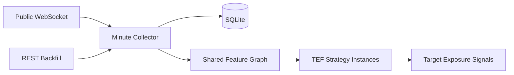

# AutoTradeMachine_Omega


[](./README.ko.md)

---

### 📖 Project Introduction

**Auto Trade Machine Omega (ATM-Omega)** is the successor to [ATM-Eta](https://github.com/kimlvis31/AutoTradeMachine_Eta), rebuilding its market-data, analysis, and trading components around explicit module boundaries. The project carries forward Eta's **TEF (Target Exposure Factor)** strategy interface and 1-minute data foundation while separating strategy calculations, account state, exchange communication, and process control.

The long-term goal is a consistent **Build → Test → Execute** workflow for strategy research and trading. The current repository provides the core libraries, a public market-data collector, and migrated strategy calculations. A complete desktop application, integrated live-trading runtime, and backtesting interface are still being developed.

#### Core Capabilities

- **Real-time Market Data Pipeline** — Collects closed 1-minute candles from Binance Spot and USD-M Futures. WebSocket ingestion is combined with REST backfill, ordered delivery, duplicate detection, and explicit handling of missing or conflicting data.
- **Shared Multi-timeframe Analysis** — Derives higher-interval close values from the same 1-minute input. EMA and MMACD calculations can be shared across strategy instances through a feature dependency graph. Incomplete higher intervals are evaluated as previews without committing closed-bar state.
- **TEF-Based Strategy Modules** — Six completed Eta TEF calculation models have been migrated, with validated parameters and independent state per instance. Strategies return normalized exposure targets rather than sending exchange orders.
- **Exchange Adapter Boundaries** — Spot and USD-M Futures adapters separate market data, account queries, and ordinary order operations. Provider interfaces allow additional exchanges to be integrated without embedding exchange payloads in strategy code.
- **Trading State and Recovery Foundations** — Decimal accounting, fill deduplication, balance reservations, entry gates, durable order intent records, and explicit handling of unknown order outcomes.
- **Process Isolation Foundations** — A spawn-based control-process prototype and bounded JSON IPC provide the starting point for independently managed services.

Broker mutations are disabled by default. The public collector does not load account credentials or create trading adapters. The integrated account reconciliation, position management, and live execution runtime are not yet complete.

---

### ▶️ How To Run

Clone the repository and enter its root directory:

```sh
git clone git@github.com:kimlvis31/atm-omega.git
cd atm-omega
```

#### Windows 🪟

```powershell
py -3.13 -m venv .venv
.venv/Scripts/python.exe -m pip install -e ".[streaming]"
.venv/Scripts/omega-collect.exe --market usdm --symbols BTCUSDT ETHUSDT --database data/usdm.sqlite
```

#### Linux 🐧

```sh
python3.13 -m venv .venv
.venv/bin/python -m pip install -e ".[streaming]"
.venv/bin/omega-collect --market usdm --symbols BTCUSDT ETHUSDT --database data/usdm.sqlite
```

Use `--market spot` for Binance Spot. `--lookback-minutes` controls the initial history window; the default is 500 and the supported range is 1–20,000 minutes. Run `omega-collect --help` through the virtual environment for all options. Stop collection with **Ctrl+C**.

The collector uses public endpoints and stores data in the selected SQLite database. It requires neither an API key nor Docker. Each invocation supports one market and up to 128 unique symbols. API availability and rate limits depend on the exchange and network environment.

---

### ✅ Requirements

| Component | Requirement |
| :--- | :--- |
| Python | CPython 3.13; development tools are pinned to 3.13.16 |
| Operating system | Windows or Linux; full cross-platform validation is in progress |
| Runtime | Standard library for the core/REST layer; `websockets` for streaming |
| Storage | Writable local storage for the selected SQLite database |
| Network | Access to Binance public REST and WebSocket endpoints for collection |

The core has no GUI, GPU, or neural-network framework dependency. Resource requirements depend on the number of instruments and consumers; a production capacity benchmark has not yet been established.

---

### 🧱 System Architecture

| Layer | Responsibility |
| :--- | :--- |
| `domain` | Trading values, accounting, reservations, and safety gates |
| `ports` | Contracts for providers, storage, analysis, strategies, and external models |
| `application` | Order coordination, continuous minute delivery, and strategy orchestration |
| `analysis` | Shared feature graph and EMA/MMACD calculations |
| `strategies` | TEF models, parameter validation, and per-instance calculation state |
| `infrastructure` | Binance REST/WebSocket adapters, request budgets, SQLite, and JSONL |
| `runtime` | Bootstrap configuration, IPC, process lifecycle, and the collection entry point |

The domain does not import infrastructure. Analysis and strategy modules have no broker connection. Application services depend on ports, while runtime code connects concrete implementations.



The collector commits a candle before delivering it downstream. A gap blocks delivery beyond the missing minute until recovery. Conflicting closed candles retain the original stored value and surface an error. Unavailable data is not silently replaced with zero or interpolated.

[config/master.config.example.toml](./config/master.config.example.toml) documents the bootstrap configuration accepted by the configuration loader. The public collector is configured separately through its CLI options.

---

### 🧠 TEF Strategy Interface

A **TEF** expresses a desired exposure in `[-1.0, +1.0]`: the sign represents direction and the magnitude represents relative exposure. Allocation, instrument capabilities, and risk controls remain separate from the strategy calculation.

| Migrated model | Analysis dependencies |
| :--- | :--- |
| `MMACDDEFAULT` | MMACD |
| `BSCALPHA` | EMA and MMACD across higher intervals |
| `BSCBETA` | EMA, MMACD, DMI/ADX, and MFI |
| `CGALPHA` | MMACD, DMI/ADX, MFI, PSAR, NES, WOI, and optional IVP levels |
| `PATHFINDER` | Market sentiment and short-term scalar |
| `SPDDEFAULT` | Swing reference price and type |

All six calculation models are migrated. EMA/MMACD feature generation is implemented; additional indicator generators required by the other four models are still being ported. Missing required features produce no decision. The unfinished Eta model `BSCDELTA` is excluded.

Legacy direction-plus-magnitude sizing is preserved when converting the model result into a signed target. Parameters that cause undefined calculations are rejected, and duplicate input does not advance the tracker twice. These targets are not direct order instructions; for example, a negative target alone cannot authorize a short position on Spot.

---

### 🧪 Development & Verification

Install the platform-specific development lock in the virtual environment:

```powershell
# Windows
.venv/Scripts/python.exe -I -m pip --isolated install --require-hashes --only-binary=:all: -r requirements/dev-win-cp313.lock
.venv/Scripts/python.exe -I -m ruff check src tests
.venv/Scripts/python.exe -I -m ruff format --check src tests
.venv/Scripts/python.exe -I -m pytest -q
```

```sh
# Linux
.venv/bin/python -I -m pip --isolated install --require-hashes --only-binary=:all: -r requirements/dev-linux-cp313.lock
.venv/bin/python -I -m ruff check src tests
.venv/bin/python -I -m ruff format --check src tests
.venv/bin/python -I -m pytest -q
```

Tests cover accounting, duplicate fills, order-intent durability, unknown outcomes, collection recovery, IPC, configuration, and dependency boundaries. Frozen synthetic sequences compare migrated TEF and EMA/MMACD calculations against Eta, alongside independently specified edge cases. External DNS and exchange connections are blocked during tests; Windows' internal asyncio socketpair is allowed.

GitHub Actions is configured for guarded manual Windows/Linux checks. Local verification remains available without using hosted runners. Test results do not establish live-trading readiness or profitability.

---

### 🔗 Related Projects

- [AutoTradeMachine_Eta](https://github.com/kimlvis31/AutoTradeMachine_Eta) — The original trading and analysis platform.
- [TEFFPSeeker](https://github.com/kimlvis31/TEFFPSeeker) — The companion strategy-parameter research project. Its GPU research informs future work; its engine is not yet integrated into Omega.
