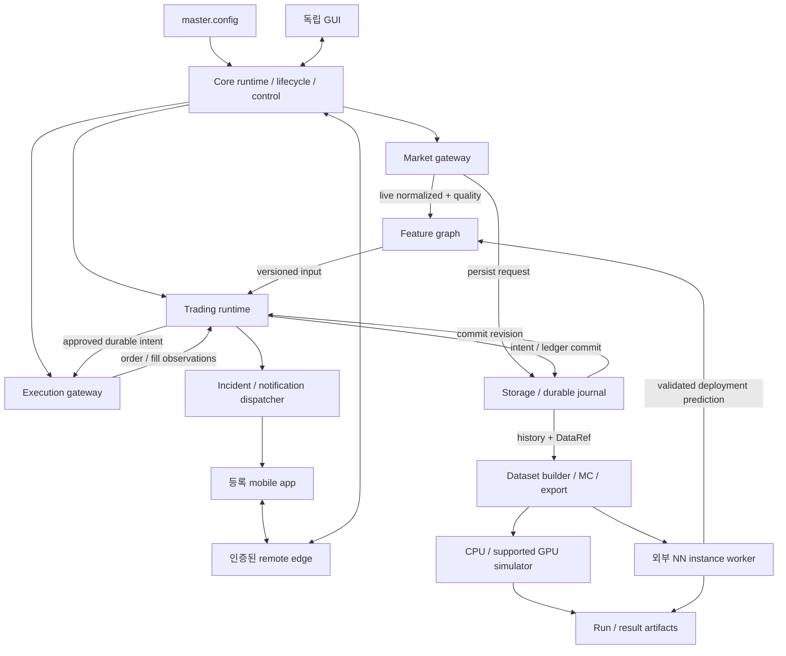

# Omega 상세 설계 패키지

2026-10-24 / v0.6 설계 기준. 이후 U49로 Binance 현물/USDM 중심 새 코드와 격리 테스트·빌드를 추가했다. 기존 ATM 소스/운영 설정/DB는 보존한다. 실제 완료 범위는 [최신 구현 상태](../implementation/README.md)를 따른다. 설계 예시 JSON/TOML은 실제 거래/학습 결과가 아니다.

[전체 로드맵](../omega-roadmap.md)을 상위 요구사항으로 삼는다. 사용자 확정 사항과 개발 측 제안을 구분하고, 미결 정책은 [질문·결정 목록](decisions-and-questions.md)에 남겼다. 제안이 이미 운영 검증된 구조라는 의미는 아니다.

## 읽는 순서

2026-10-24 추가: Python venv·고정 파일, 삼성증권 조사, 소형 fixture를 준비했고 이후 U49로 새 코드 구현을 시작했다. 현재 실제 adapter는 Binance 두 시장뿐이며 실계정·기존 ATM·실DB·학습은 실행하지 않았다.

| 문서 | 구체화한 내용 |
|---|---|
| [공통 상태 계약](system-contracts.md) | gate/관리권·장애별 주문·내구 예외·복구/재인수·설정 authority |
| [상세 구현 명세](implementation-specification.md) | package/port·명령/DB 키·1분 barrier·NN·chart/3D·기본값·작업 순서 |
| [정합성 점검](consistency-audit.md) | DA01–DA17 보완 근거와 CA01–CA16 교차 검증 |
| [프로세스·runtime](process-runtime.md) | 상주 역할과 lazy worker, thread/owner, blocking wait·chunk, bootstrap·GUI·crash·종료 |
| [IPC 계약](ipc-contracts.md) | typed envelope, command/event catalog, operation·ACK·snapshot/delta·대형 배열 lease |
| [Master configuration](../omega-master-configuration.md) | headless 기본값, bootstrap/runtime 설정 구분, import 부작용 제거, CFG 검증 |
| [데이터·저장·dataset](data-storage-datasets.md) | source/normalized/feature 분리, 시간·품질·DB schema, export/MC/split/lineage |
| [거래소·증권사·갭 품질](market-adapters-and-quality.md) | 구현 목표/API 확인·모듈 계약·미제공 field·실시간 축적·보간률/causal·MX01–MX12 |
| [분석·전략·NN framework](module-frameworks.md) | descriptor/DAG·중복 제거, 외부 .py instance, 전처리/학습/평가·구조/metric/checkpoint |
| [거래·시뮬레이션](trading-simulation.md) | portfolio/reservation·order/fill/ledger·risk, live/paper/replay·CPU/GPU·연구 |
| [GUI·Settings·관측](gui-settings-observability.md) | root launch/attach·화면·자동 layout·차트·언어/테마·설정 적용·로그/성능 지표 |
| [모바일 제어](../omega-mobile-control.md) | 기기 등록·권한·알림·정지/재개·offline·접속 구성 |
| [파이프라인 안전](../omega-pipeline-safety.md) | 코드 근거→실패 조건→수정 계획, safety state·FS01–FS28 |
| [작업·검증·전환](delivery-and-verification.md) | W00–W17 작업, 첫 수직 경로, suite/CI·legacy 비교·GPU tolerance·이관 |
| [GitHub 유지보수](github-maintenance.md) | Actions PR/통합/정기/API/GPU/release·Dependabot·권한/runner·배포 gate |
| [추가 테스트 사례](extended-test-cases.md) | runtime/feature/dataset/NN/simulation/GUI/mobile/기록별 구체적 사례 |
| [요구사항 추적표](traceability.md) | R01–R40를 설계·W 작업·검증 사례에 연결 |
| [기존 모듈 대응표](legacy-mapping.md) | 자체 Python 94개 파일의 새 책임 후보와 W 작업 연결 |
| [봉 내부·파일 대체 저장](intrabar-and-storage-fallback.md) | setup 경로/비용·seed/causal/portfolio 계약·DB JSON journal·IP01–IP06 |
| [최신 운영 정책](operating-policy-details.md) | 정지/종료·수동 개입·1분 집계·local 보호·NN/기록 설명·viewer/3D·PC 알림·PO01–PO10 |
| [추천안 채택 기록](remaining-decisions.md) | P01–P06 채택·P07 개발 기본안·외부 확인/실행 검증 구분 |
| [결정·질문](decisions-and-questions.md) | 사용자 결정/허용 50개, 설계 제안 18개·최신 구현 범위 |

## 구조 개요

아래는 논리 연결을 보여주며 모든 box가 별도 process라는 뜻은 아니다. 최초 physical 제안은 runtime 문서를 따른다.

데이터 live 배포와 archive commit은 상태를 구분한다. 거래소 제출과 DB commit은 단일 transaction이 아니므로 journal/operation ID/reconcile이 필요하다. GUI/mobile는 owner가 아니라 command와 view를 소비하는 client다.

## 예시 계약

| 예시 | 목적 |
|---|---|
| [master TOML](../examples/master.config.example.toml) | gui.autostart=false와 확정 safety 정책 |
| [IPC command](examples/ipc-message.example.json) | device의 수동 재개 요청, epoch·기한·operation·권한 검사 |
| [dataset manifest](examples/dataset-manifest.example.json) | source/MC/split/schema/hash·지원 입력 |
| [NN descriptor](examples/nn-module-descriptor.example.json) | 외부 module capability·입출력·config·계측 API |
| [training run](examples/training-run.example.json) | dataset→전처리→구조→metric→평가→checkpoint |
| [구조 이력](examples/architecture-history.example.json) | 고정 topology와 별도 weight/metric 기록의 synthetic 예시 |
| [simulation spec](examples/simulation-spec.example.json) | shared portfolio·dataset 고정·backend 선택 사유·trace |
| [control policy](examples/control-policy.example.json) | 채택 정책과 P07 개발 기본안·volatile 상태 구분 |
| [journal record](examples/journal-record.example.json) | event identity·단위·provider scope·미실행 내구 상태 |
| [작업 선행 graph](examples/work-packages.example.json) | W00–W17의 기본/조건부 선행·릴리스 capability gate |
| [test catalog](examples/test-catalog.json) | critical 66개 + 추가 64개, 총 130개 planned inventory와 독립 수기 fixture |

예시의 0으로 채운 hash·artifact ID·metric·구조 변화는 placeholder/synthetic이며 실제 파일·성과·실행을 증명하지 않는다. formal schema/loader와 runtime 검증은 구현 작업에서 연결한다.

문서 링크·예제 문법·질문/테스트 ID·원본 hash 확인 결과는 [검토 상태](review-status.json)에 남겼다. 문서 정합성 확인과 애플리케이션 테스트 통과는 구분한다.

## 현재 준비 상태와 남은 일

설계 수준에서 process/state owner·수명, 메시지/대형 데이터 계약, pipeline transaction과 품질, module/input/output, training source, portfolio simulation, UI/mobile, 작업·검증·legacy 대응을 마련했다. 각 설계는 실제 구현 전 현재 사용자 운영 범위와 미결 정책에 맞춰 조정한다.

추천안 P01–P06과 P07 원칙을 반영하고 공통 상태/상세 구현 명세·교차 검증을 보완했다. P07의 구체 제출 주문 처리는 개발 기본안으로 표시한다. 외부 API/장치/성능과 실제 안전 검증은 별도 증거가 필요하다. U49로 새 코드 구현을 허용했으며 실제 범위는 docs/implementation에서 추적한다. W00–W03과 W05를 초기 구현 경로로 두고 viewer W17을 추가했다. 이 문서만으로 안전 구현·목표 성능·GPU 가속·모바일 알림이 완료됐다고 평가하지 않는다.
